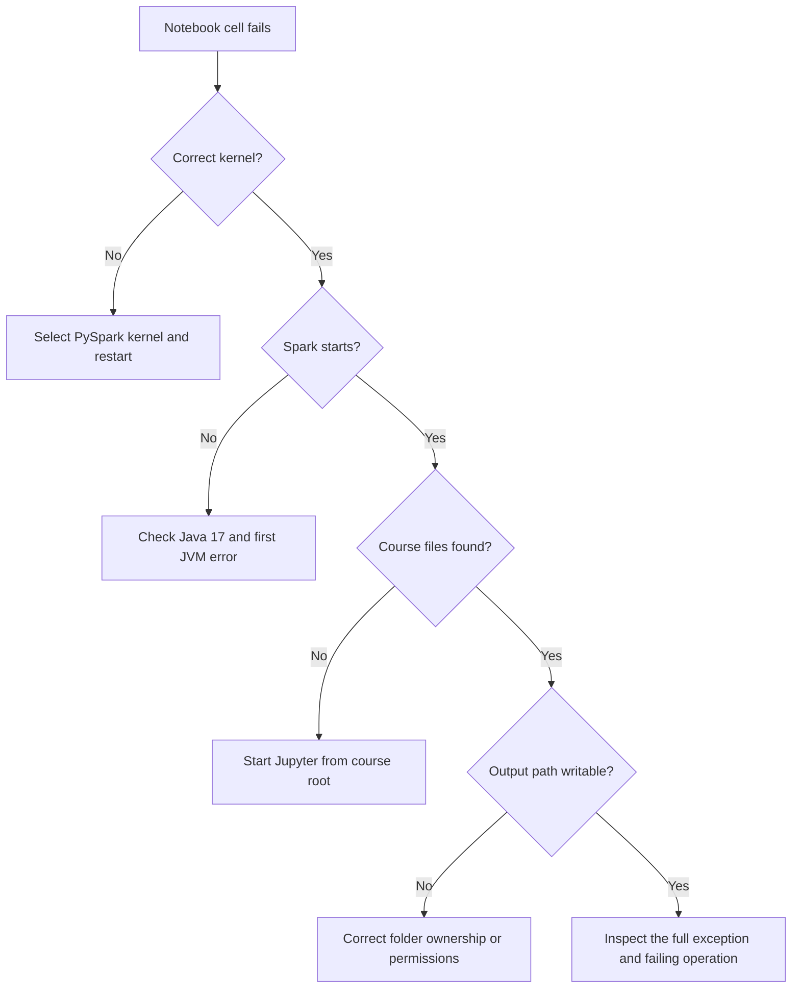

# Environment setup and verification

[← Course syllabus](../README.md) · [Quick reference](QUICK_REFERENCE.md) · [Section 01 →](../01-spark-foundations/README.md)

The environment is prepared before the course begins. Use this page to verify it and resolve common startup problems.

## Expected environment

| Component | Expected value |
|---|---|
| Operating system | Ubuntu 22.04 LTS x86_64 |
| Java | OpenJDK 17 |
| Python | 3.12.x |
| PySpark | 4.1.4 |
| JupyterLab | 4.x |
| Spark master | `local[2]` |

## Verify the environment

From the course root:

```bash
java -version
python3.12 --version
python3.12 -c "import pyspark; print(pyspark.__version__)"
python3.12 00-setup/scripts/validate_final_package.py
python3.12 00-setup/scripts/smoke_test.py
```

Start Jupyter:

```bash
bash 00-setup/scripts/launch_jupyter.sh
```

Choose the **PySpark 4.1.4 (Python 3.12)** kernel.

## Notebook verification

```python
import sys
print(sys.executable)
print(sys.version)

from training_lib import create_spark
spark = create_spark("environment-check")
print(spark.version)
print(spark.sparkContext.master)
```

## Troubleshooting path



### Wrong Python kernel

```python
import sys
print(sys.executable)
```

Restart with the prepared PySpark kernel when this path differs from the expected environment.

### Java gateway does not start

Check `java -version`, `JAVA_HOME` and the first Java error in the output. The supplied launchers use `SPARK_LOCAL_IP=127.0.0.1` for local execution.

### Files are not found

Stop Jupyter and restart it from the course root with `00-setup/scripts/launch_jupyter.sh`.

### Cast fails on malformed text

Use `try_cast`, as shown in Section 03, so malformed values can be classified.

### Output already exists

The course notebooks write only beneath `output/` and `07-guided-project/project/destination/`. Verify the destination before running a cell that uses overwrite mode.

### Several Spark sessions are active

Shut down unused notebook kernels. Each active kernel can own a separate Spark JVM.

The optional installer and its detailed validation scripts are available under `00-setup/installer/ubuntu-pyspark-setup/`.

