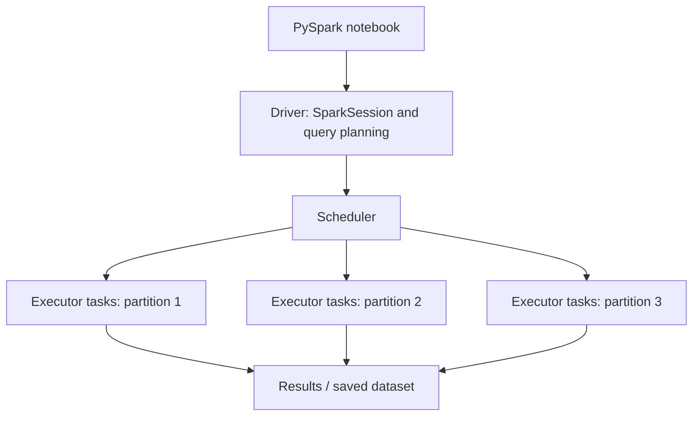
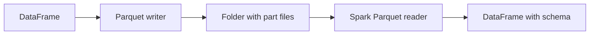
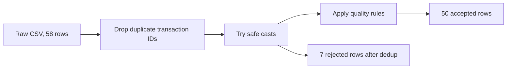
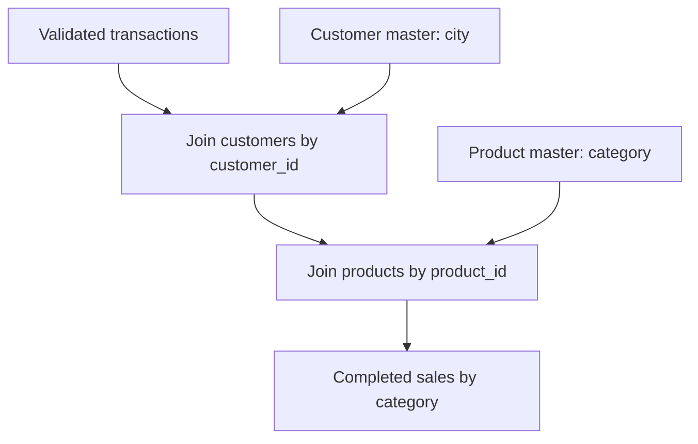
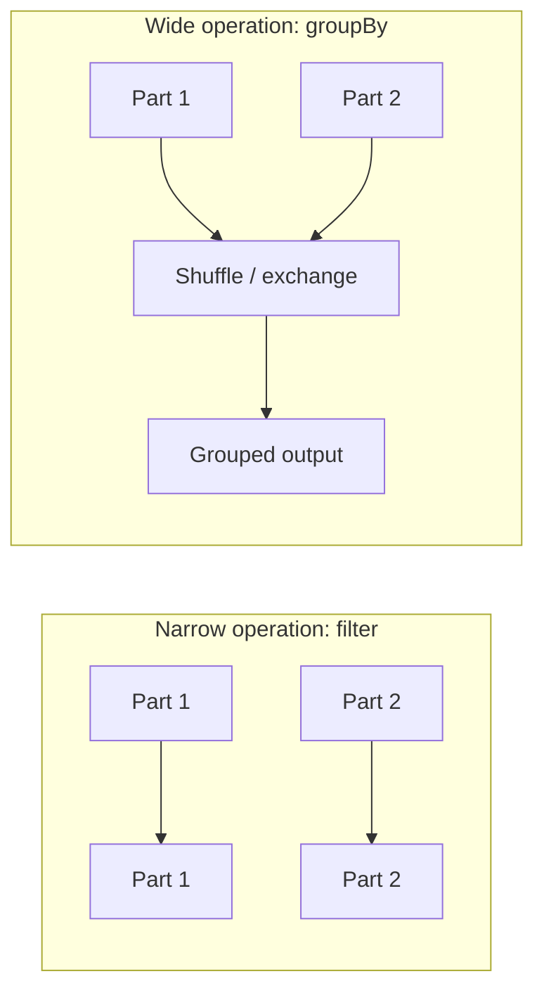
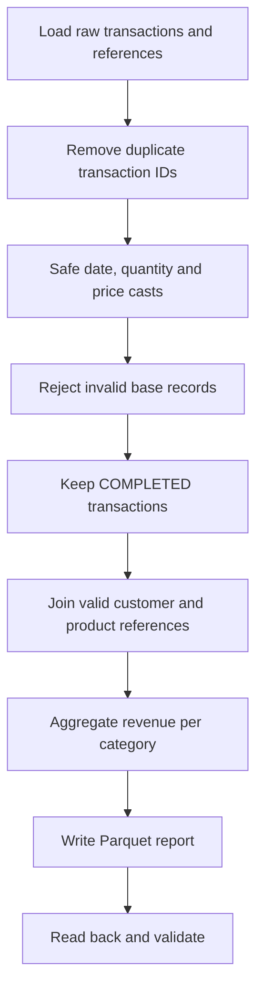

# Apache Spark Fundamentals — Presenter’s Complete Markdown Guide

> The final presentation is [`PRESENTATION.md`](PRESENTATION.md), updated for the confirmed schedule and multi-run project. This original deck remains as supplemental detail.

**Use this file as the single Markdown presentation.** Open it in a Markdown previewer and navigate by heading. Run matching notebooks for hands-on steps.


---

# 01. Introduction to Apache Spark

**Duration:** 30 minutes  
**Notebook:** `01_introduction.ipynb`  
**Outcome:** Explain when Spark helps, identify driver/executors/partitions, and distinguish a transformation from an action.

---

## Why do we need Spark?

A data analyst might inspect 100,000 rows with SQL or Python. In business, a transaction system can create millions or billions of records, and one computer's memory or time may not be sufficient. Spark provides an engine for executing data processing tasks using multiple CPU cores or multiple machines, with high-level DataFrame and SQL APIs.

**Important nuance:** Spark is not automatically faster for small files. Starting the JVM, scheduling tasks, and moving data involve overhead. For a small lookup, plain Python or SQL can be simpler and faster.

### Four common needs

- Read files from common formats and storage systems.
- Transform, filter, join and summarize large datasets.
- Process in parallel across partitions.
- Save reusable results for downstream analytics.

## The architecture at a glance



**Driver:** Entry point coordinating the Spark application and scheduling work. In this workshop, the notebook runs the driver locally.  
**Executors:** Compute resources that process tasks and can cache data; in a real cluster these typically run across worker nodes. In local mode, tasks run locally rather than on separate machines.  
**Partitions:** Units into which Spark divides data for parallel computation. Partitions are *not* equal to rows, CPU cores, database partitions, or machines.  
**Task:** Work assigned to process one partition within a stage.

### Processing flow


A Spark DataFrame program builds a plan; Spark starts actual execution on an **action** such as `show()`, `count()`, `collect()`, or a write operation.

## API example

```python
from pyspark.sql import SparkSession, functions as F
spark = SparkSession.builder.master('local[2]').appName('Intro').getOrCreate()

df = spark.range(1, 11)
transformed = df.withColumn('double_id', F.col('id') * 2)  # transformation
transformed.show()  # action
```

Use the notebook to show `spark_partition_id()` and how many partitions were created. The example is illustrative; repartitioning and scheduling are not meaningful performance benchmarks on a few records.

## Useful comparisons

| Concept | Description | Example |
|---|---|---|
| DataFrame | Distributed, named-column dataset | Transactions loaded from CSV |
| Transformation | Builds a new DataFrame plan | `filter`, `select`, `withColumn`, `join` |
| Action | Triggers execution | `show`, `count`, `write` |
| Narrow transformation | Each output partition depends on limited input partitions | `filter`, most `select` operations |
| Wide transformation | Usually requires data redistribution | `groupBy`, many joins |
| Local mode | Spark jobs run on one machine | `.master('local[2]')` |
| Cluster mode | Distributed execution across workers | YARN / Kubernetes / Spark standalone |

## Participant activity (8 minutes)

1. Start a local SparkSession.
2. Create a DataFrame with numbers 1–12 and four partitions.
3. Add a derived column containing the original number times 2.
4. Use `show()` and `count()`; identify the action.

## Quick discussion

**Q:** Why can a DataFrame support the same operations with 1,000 rows and millions of rows?  
**A:** The API describes transformations; Spark chooses a distributed execution plan using partitions and tasks.

**Q:** Is a Python list the same as a Spark DataFrame?  
**A:** No. Lists are regular Python objects in one Python process; Spark DataFrames represent distributed query plans executed by Spark.

**Q:** Does Spark eliminate the need for SQL?  
**A:** No. Spark SQL is a major part of Spark and supports familiar SQL queries against DataFrames and tables.

**Checkpoint:** Students can explain a driver, a partition, and an action without relying on jargon.


---

# 02. Getting Started with PySpark

**Duration:** 45 minutes  
**Notebook:** `02_getting_started.ipynb`  
**Outcome:** Create a SparkSession, load CSV/JSON/TSV, create a DataFrame from Python values, and read/write Parquet.

---

## The environment

The workshop uses Ubuntu 22.04 LTS, OpenJDK 17, Python 3.12.3, and Spark 4.1.x in Jupyter. The notebook must have access to both `pyspark` and a working Java executable. Run the preflight and smoke test before the group joins.

```python
import sys
import pyspark
print(sys.executable)
print(pyspark.__version__)
```

## Create SparkSession

```python
from pyspark.sql import SparkSession
spark = (SparkSession.builder
    .master('local[2]')
    .appName('Ecommerce-Foundations')
    .config('spark.sql.shuffle.partitions', '4')
    .getOrCreate())
print(spark.version)
```

The common helper in `training_lib.py` creates the same session, while also directing local Python workers to the notebook's interpreter. `SparkSession` is the normal DataFrame/SQL entry point. `local[2]` is two local execution threads, not a cluster with two nodes.

## Loading structured files

**CSV:**

```python
transactions = (spark.read.option('header', True)
                .csv('data/transactions.csv'))
transactions.printSchema()
transactions.show(5, truncate=False)
```

Most data fields will initially be strings, which is deliberate: the transactions file includes invalid numeric strings and nulls. Real projects often define explicit schemas after agreeing on data-quality rules rather than accepting all inferred types.

**JSON Lines (one object per line):**

```python
products = spark.read.json('data/products.json')
products.printSchema()
```

**TSV:**

```python
products_tsv = (spark.read.option('header', True)
                .option('sep', '\t')
                .csv('data/products.tsv'))
```

**Python values:**

```python
sample = spark.createDataFrame([('Pune', 20), ('Mumbai', 30)], ['city', 'orders'])
sample.show()
```

This is useful for small teaching samples. Large production data should normally be read from files or storage systems rather than materialized as Python lists on the driver.

## What happens with Parquet?



Parquet is columnar and retains a structured schema. CSV is text; it needs parsing and explicit interpretation of types. Spark writes a Parquet dataset as a **directory**, potentially with several part files.

```python
products.write.mode('overwrite').parquet('output/products_sample_parquet')
reloaded = spark.read.parquet('output/products_sample_parquet')
reloaded.printSchema()
```

Only write into `output/` in these demonstrations. Overwrite mode replaces the **destination dataset path**, not an individual row.

## Reading and verifying results

| Function | Purpose |
|---|---|
| `printSchema()` | Types and nested structure |
| `show(5, truncate=False)` | Preview selected records |
| `count()` | Number of records (triggers a job) |
| `columns` | List the column names |
| `dtypes` | Column names and Spark types |
| `limit(5)` | Construct a limited DataFrame (action only when displayed/collected) |

## Participant exercises (12 minutes)

1. Read `customers.csv` and display its first five records.
2. Read `products.json`, print its schema, and count records (expected: **12**).
3. Read `products.tsv` by setting the delimiter to a tab. How does its schema differ from JSON?
4. Save products to Parquet and read them back. Verify the row count remains 12.

## Common mistakes and answers

**Why didn't one `.parquet` file appear?** Spark writes a dataset directory; check its `part-*` files.  
**Should I always use `inferSchema=True`?** No. It performs type inference; this workshop deliberately preserves raw string fields so bad values can be identified.  
**What is the difference between `read` and `write`?** The reader creates a DataFrame from sources; the writer is an action that persists output.

**Checkpoint:** Students can load CSV, JSON and TSV independently and complete a local Parquet round-trip.


---

# 03. DataFrame Fundamentals

**Duration:** 75 minutes  
**Notebook:** `03_dataframe_fundamentals.ipynb`  
**Outcome:** Select, filter, derive, cast and clean data; recognize duplicates, bad types and missing values.

---

## The business problem

An online retailer receives transactions from multiple sources. Some are repeated, have missing quantities or prices, or refer to products that do not exist. An analytical report should not treat all incoming rows as reliable facts.



## Select the required fields

```python
raw.select('transaction_id', 'product_id', 'quantity', 'status').show(10)
```

Use `select` rather than transporting every column through every transformation. A Spark DataFrame is immutable: selecting columns produces a new DataFrame; it does not change the original.

## Filter rows

```python
from pyspark.sql import functions as F
completed = raw.filter(F.col('status') == 'COMPLETED')
completed.show(5)
```

Multiple conditions require careful parentheses because PySpark uses `&` and `|` for column expressions:

```python
raw.filter(
    (F.col('status') == 'COMPLETED') &
    (F.col('product_id') == 'P001')
).show()
```

## Derive a column

A new field can be created with `withColumn`:

```python
example = spark.createDataFrame([(2, 199.0), (3, 50.0)], ['qty', 'price'])
example = example.withColumn('line_total', F.col('qty') * F.col('price'))
example.show()
```

In the project, money uses a Spark **DECIMAL** type rather than floating-point arithmetic to avoid avoidable rounding surprises.

## Cast types safely

Spark 4.1 can raise an exception for malformed `cast()` inputs under ANSI behavior. Our raw quantity sometimes contains `not-a-number`. Use `try_cast` to produce `NULL` and isolate the failed records:

```python
typed = (raw
    .dropDuplicates(['transaction_id'])
    .withColumn('order_date', F.expr('try_cast(transaction_date as date)'))
    .withColumn('qty', F.expr('try_cast(quantity as int)'))
    .withColumn('price', F.expr('try_cast(unit_price as decimal(12,2))')))
```

**Why use `try_cast`?** An invalid string turns into null, so the batch can continue and the record can be reported/rejected deliberately. This does **not** mean errors should always be silently swallowed. Keep visibility of rejected rows.

## Missing values and duplicates

```python
raw.groupBy('transaction_id').count().filter(F.col('count') > 1).show()
```

There are **58 raw records** but **57 distinct transaction IDs**, because one identical source transaction is repeated. `dropDuplicates(['transaction_id'])` is appropriate for this known duplicate. If duplicate IDs had conflicting values, a real pipeline would need a deterministic winner rule (for example, latest update timestamp) instead of arbitrary deduplication.

Missing and malformed rows are recognized after typing:

```python
from training_lib import quality_condition
rejected = typed.filter(~quality_condition())
rejected.select('transaction_id','quantity','unit_price','transaction_date').show()
```

Rules: parsed date must exist; qty must be positive; price must be nonnegative; customer ID and product ID must not be blank/null. Exactly **7** rows fail these basic rules after deduplication. Those failures include null or invalid quantity, price, date and missing keys.

A product ID like `P999` is not an empty key; it is an *unknown reference*. That is a different quality issue which we detect during joins, not during basic type validation.

## Clean and derive final amount

```python
clean = (typed
    .filter(quality_condition())
    .withColumn('line_total', F.col('qty') * F.col('price')))
assert clean.count() == 50
```

## Why avoid `collect()` on large data?

`collect()` moves all result rows to the Python driver. It is fine for tiny checks, but dangerous for large production datasets. Prefer `show()`, grouped metrics, or persisting the result. `toPandas()` is also driver-memory bound.

## Practice lab (25 minutes)

1. Show the IDs of transactions with more than 2 items.
2. Count transactions by status in the cleaned dataset.
3. Identify records with invalid typed dates or prices.
4. Verify `58 raw → 57 unique → 50 clean`.
5. Explain why `P999` should remain after basic type validation but must be excluded if it cannot match the product master.

## Interview-style quick checks

**Q:** `drop()` vs `dropDuplicates()`?  
**A:** `drop()` removes columns; `dropDuplicates()` removes repeated rows/keys.

**Q:** `filter()` vs `where()`?  
**A:** Both filter rows; `where` is an alias for `filter`.

**Q:** `cast()` vs `try_cast()`?  
**A:** A strict cast may error on malformed strings; `try_cast` yields null for invalid input.

**Q:** Can `fillna()` fix all missing values?  
**A:** No. Filling only makes sense when the chosen replacement has business meaning. For unknown transaction quantity or price, rejection or remediation is usually safer than inventing values.

**Checkpoint:** 50 base-quality rows are ready for aggregation and reference joins.


---

# 04. Aggregations and Spark SQL

**Duration:** 60 minutes  
**Notebook:** `04_aggregations_and_sql.ipynb`  
**Outcome:** Group transactions, compute summaries, register temporary views, and query with Spark SQL.

---

## Business question

The retailer wants category-level sales and daily completed-sales revenue. Only transactions that satisfy all of these rules count toward reported revenue:

1. The transaction ID is not a duplicate.
2. Quantity/date/price/customer/product key passes base quality checks.
3. `status = COMPLETED`.
4. Both customer and product IDs match the reference tables.

We remove bad transactions *before* aggregate reporting. The transformation module produced 50 base-quality records. Two of those are completed but have unmatched reference IDs; after completed-status filtering and matching references, **36** records qualify for the business report.

## Group by status

```python
clean.groupBy('status').count().orderBy('status').show()
```

This counts records in each status category. It does **not** tell us revenue until we apply the metric definition.

## Join to enrich the fact table

```python
from training_lib import completed_enriched
enriched = completed_enriched(clean, customers, products)
```

The join details are explained in the next module. Here we use the result to focus on aggregates.

## Group by and summary metrics

```python
from pyspark.sql import functions as F
by_category = (enriched.groupBy('category')
    .agg(
        F.countDistinct('transaction_id').alias('orders'),
        F.sum('line_total').alias('revenue')
    )
    .orderBy('category'))
by_category.show(truncate=False)
```

| Column | Meaning | Why it matters |
|---|---|---|
| `category` | Product grouping | Business drilldown |
| `orders` | Distinct transaction IDs | Prevent duplicate order inflation |
| `revenue` | Sum of quantity × unit price | Completed-sales value |

**Important:** Our synthetic data has one row per transaction ID. A real order header can contain many order lines, so in that case `COUNT(DISTINCT order_id)` is different from `COUNT(*)`.

## Expected result

| Category | Orders | Revenue |
|---|---:|---:|
| Accessories | 16 | 52574.00 |
| Audio | 4 | 20992.00 |
| Electronics | 12 | 265968.00 |
| Stationery | 4 | 2694.00 |
| **Total** | **36** | **342228.00** |

These are expected figures for the supplied dataset. Currency is illustrative; the goal is consistent transformation, not financial accounting or tax treatment.

## The same logic using Spark SQL

```python
enriched.createOrReplaceTempView('sales_valid')
result = spark.sql('''
    SELECT category,
           COUNT(DISTINCT transaction_id) AS orders,
           SUM(line_total) AS revenue
    FROM sales_valid
    GROUP BY category
    ORDER BY category
''')
result.show()
```

A temporary view registers a DataFrame query in the current SparkSession. It is not automatically saved as a durable table or file. A view's name can be reused with `createOrReplaceTempView`.

## SQL vs DataFrame API

| Topic | DataFrame API | Spark SQL |
|---|---|---|
| Select | `.select('category')` | `SELECT category` |
| Filter | `.filter(F.col('status') == 'COMPLETED')` | `WHERE status = 'COMPLETED'` |
| Aggregate | `.groupBy('category').agg(F.sum('line_total'))` | `GROUP BY category` / `SUM(line_total)` |
| Join | `.join(other, 'product_id')` | `JOIN ... ON ...` |
| Execution | Spark optimizer plans query | Same Spark optimizer plans query |

Avoid claiming SQL is intrinsically faster than equivalent DataFrame operations. Their logical plans often optimize similarly.

## Date-level analytics

```python
(enriched.groupBy('order_date')
 .agg(F.count('*').alias('sales_rows'), F.sum('line_total').alias('daily_revenue'))
 .orderBy('order_date')
 .show())
```

This provides a basic daily revenue trend. The actual status and valid-reference rules continue to apply; do not replace `enriched` with raw CSV by accident.

## Practice lab (20 minutes)

1. Create completed-sales revenue by city and sort city names.
2. Write a Spark SQL query for category revenue.
3. Compute the daily number of qualifying sales.
4. Compare `COUNT(*)` with `COUNT(DISTINCT transaction_id)` on the original raw dataset.
5. Verify total qualifying completed revenue is 342228.00.

## Questions to check understanding

**Is `groupBy` a narrow transformation?** Normally not: grouping by a key commonly redistributes records by that key and causes a shuffle.  
**Does `show()` return the full DataFrame to Python?** No; it displays a small sample.  
**Why choose DECIMAL for price?** Binary floating point can represent many decimal amounts approximately, which can distort money calculations.  
**How long does a temporary view live?** It is scoped to the active SparkSession, not permanent storage.

**Checkpoint:** Both DataFrame and SQL produce the same four category totals.


---

# 05. Joining and Saving Data

**Duration:** 60 minutes  
**Notebook:** `05_joins_and_saving.ipynb`  
**Outcome:** Explain join types, diagnose unmatched foreign keys, and save Parquet/CSV summary folders.

---

## The reference-data problem

A transaction has `product_id` and `customer_id` fields, but the sales CSV does not contain category and city. We need to combine the fact records with product and customer reference datasets.



Two intentional source exceptions are present: `P999` is missing from products, and `C999` is missing from customers. They look like non-empty IDs and pass simple column validation, but cannot be matched to reference data.

## Inner join

```python
completed = clean.filter(F.col('status') == 'COMPLETED')
with_customer = completed.join(customers, 'customer_id', 'inner')
with_both = with_customer.join(products, 'product_id', 'inner')
```

An inner join keeps only rows with matching keys on both sides. It is correct here because the sales metric explicitly excludes transactions with unknown product or customer references. In a different business use case, rejecting those transactions could hide important operational problems; keep a reject report as well.

## Left join

```python
left_view = completed.join(products, 'product_id', 'left')
left_view.filter(F.col('category').isNull()).show()
```

A left join keeps all left-hand rows, even if a product is missing. The product fields appear as null for unmatched rows. This is useful for diagnosing reference integrity instead of quietly losing records.

## Left-anti join

```python
unmatched_products = completed.join(products.select('product_id'), 'product_id', 'left_anti')
unmatched_customers = completed.join(customers.select('customer_id'), 'customer_id', 'left_anti')
unmatched_products.select('transaction_id', 'product_id').show()
unmatched_customers.select('transaction_id', 'customer_id').show()
```

Each anti join produces **one** unmatched completed row in the supplied dataset. An anti join returns left-side rows with no matching key on the right.

## Join-type mental model

| Join | Keeps | Workshop example |
|---|---|---|
| Inner | Only matching rows | Accepted reporting facts |
| Left | All left rows; nullable dimension fields | Find unresolved category |
| Right | All right rows; nullable fact fields | Include every product even if unsold |
| Full | All rows from both sides | Compare two inconsistent sets |
| Left semi | Left rows that have a right match (no right columns) | Membership check |
| Left anti | Left rows without a right match | Reject / missing reference report |

**Caution:** Duplicate keys in a reference table can multiply matching rows and inflate revenue. In this workshop, product and customer keys are unique. In production, validate them before joining.

## Saving data to Parquet

```python
from training_lib import completed_enriched, revenue_by_category
enriched = completed_enriched(clean, customers, products)
report = revenue_by_category(enriched)
report.write.mode('overwrite').parquet('output/category_revenue_parquet')
```

Then read the saved folder:

```python
loaded = spark.read.parquet('output/category_revenue_parquet')
loaded.orderBy('category').show()
```

The notebook resolves the full workshop path to avoid issues when Jupyter starts in `notebooks/`.

## Saving a CSV summary

```python
report.write.mode('overwrite').option('header', True).csv('output/category_revenue_csv')
```

Spark generally writes a directory containing one or more `part-*` files rather than a named `report.csv`. Production output naming, retention and overwrite safeguards are an additional orchestration concern.

## What changes when the output is larger?

When production datasets are large, think about partition counts, shuffle volume, and write patterns. Avoid forcing everything into one partition (`coalesce(1)`) just to obtain one file. That pattern creates a bottleneck for large outputs.

## Practice lab (20 minutes)

1. Join completed transactions to customers. Display transaction ID, customer name and city.
2. Join the result to products, and show product name/category.
3. Find orphan product and customer references using anti joins.
4. Save the four-row category report as Parquet; read it back and verify `count() == 4`.
5. Explain why a left join is more useful than inner join during diagnostic checks.

## Likely questions

**What happens when the join key is NULL?** Standard equality joins do not match null to null. Null-safe equality is possible but should be a conscious business decision.  
**Does inner join guarantee no duplicates?** No; duplicate keys on either side can produce many-to-many row multiplication.  
**Is Parquet a database?** No, it is a columnar file format; a directory of Parquet files is not automatically a managed transaction table.

**Checkpoint:** The output summary has four rows, and the attendee can explain why P999 and C999 were excluded.


---

# 06. Execution and Performance Basics

**Duration:** 30 minutes  
**Notebook:** `06_execution_and_performance.ipynb`  
**Outcome:** Explain laziness, task partitions, shuffle boundaries, `explain()`, and careful use of caching.

---

## Why does the same code sometimes run slowly?

Spark programs describe **what** to compute. Their performance depends on input size, partitioning, data skew, shuffles, join strategy, file sizes, memory, CPU, and available worker resources. Understanding these concepts is more valuable than memorizing one optimization switch.

## Lazy evaluation

```python
selected = clean.filter(F.col('status') == 'COMPLETED')
summary = selected.groupBy('product_id').count()
# The expressions above build a plan.
summary.show()  # Triggers execution.
```

A transformation is not a promise that nothing at all happens in the Python process; rather, it means Spark does not execute the *distributed computation* until an action requires it.

## Explain a plan

```python
summary.explain('formatted')
```

Read the output for scans, filters, exchanges (data redistribution), and aggregates. Spark may change its physical plan as it learns runtime statistics. The Spark UI, typically at `http://localhost:4040`, is useful when available; the port may change if several applications are running.

## Narrow vs wide



`filter` and `select` are usually narrow because each output partition can be computed from one input partition. A `groupBy` usually redistributes keys to the same downstream partitions. A join can shuffle, but the optimizer may choose a **broadcast join** when one side is small.

## Partition count

```python
print(clean.rdd.getNumPartitions())
repart = clean.repartition(4, 'product_id')
print(repart.rdd.getNumPartitions())
```

`repartition` can trigger a shuffle. More partitions are not always faster: very small partitions add scheduler overhead and too few partitions reduce parallel work. The workshop sets shuffle partitions to four for lightweight demonstrations, not as a universal recommendation.

## Cache and reuse

```python
shared = clean.filter(F.col('status') == 'COMPLETED').cache()
shared.count()  # First action computes and populates cache.
shared.groupBy('product_id').count().show()
shared.unpersist()
```

Caching is helpful when the same transformed dataset is reused for multiple expensive actions and memory is available. Caching every DataFrame wastes resources. Compare explain plans and actual workloads; don't claim speedups based on this 58-row toy dataset.

## Sensible Spark habits

- Read only necessary columns, filter as early as business correctness permits.
- Use built-in DataFrame/SQL functions before considering Python UDFs.
- Avoid `collect()` for large DataFrames, especially in shared notebook servers.
- Inspect execution plans for heavy join/groupBy operations.
- Verify output correctness first; optimize after measuring bottlenecks.
- Avoid a single huge output partition just to make a conveniently named file.

## Practice lab (8 minutes)

1. Build a grouped summary and call `.explain('formatted')`.
2. Point out a likely `Exchange`/shuffle in the plan.
3. Repartition data into four partitions and display partition ID counts.
4. Cache a DataFrame, perform two actions, then unpersist it.

## Quick questions

**Is `cache()` an action?** No. It marks a DataFrame for caching when computed by an action.  
**Does every join require a shuffle?** No; for example, broadcast joins can avoid a large two-sided shuffle.  
**Does more memory always fix a slow query?** No. Skew, network exchange, data format and algorithmic behavior may dominate.  
**Is `groupBy` always expensive?** Cost depends on data size and distribution; grouping commonly triggers shuffle.

**Checkpoint:** Students can identify an action, interpret the significance of `Exchange`, and explain when caching is sensible.


---

# 07. Guided Mini-Project — E-commerce Sales Analytics

**Duration:** 60 minutes, plus 15 minutes for validation after the project  
**Notebooks:** `07_guided_project_starter.ipynb` and `08_project_reference_solution.ipynb`  
**Final deliverable:** A working notebook and `output/project_category_revenue_parquet/` containing the completed-sales summary.

---

## Industry-style requirement

An e-commerce business exports daily transaction records and keeps customer/product reference files. Build a small, auditable pipeline that produces **completed revenue by product category**. The incoming transaction data is unreliable and can contain missing values, duplicates, invalid types, cancelled/returned statuses, and reference IDs absent from dimension tables.

### Source files

| File | Format | Key fields | Purpose |
|---|---|---|---|
| `transactions.csv` | CSV | transaction_id, transaction_date, customer_id, product_id, quantity, unit_price, status | Transaction facts |
| `customers.csv` | CSV | customer_id, customer_name, city | Customer reference |
| `products.json` | JSON Lines | product_id, product_name, category, list_price | Product reference |
| `products.tsv` | TSV | product_id, product_name, category, list_price | Alternative format demonstration |

## Required steps



### The contract

- Use unique `transaction_id` values and do not double-count a duplicated row.
- A valid transaction has a parseable date, integer quantity greater than zero, decimal price greater than or equal to zero, and nonempty customer and product keys.
- Revenue is counted only for `COMPLETED` transactions whose product ID and customer ID match the references.
- `line_total = qty * price`.
- The report includes `category`, `orders` (`countDistinct(transaction_id)`) and `revenue` (`sum(line_total)`).
- Output is a Parquet **directory**, created under `output/`.

## Exercise steps and timings

| Time | Step | Observable result |
|---|---|---|
| 0–10 min | Load and inspect | 58 raw records |
| 10–25 min | Deduplicate, safely cast, clean | 57 unique IDs; 50 clean rows |
| 25–40 min | Apply status / dimension joins | 36 qualified completed sales |
| 40–50 min | Aggregate and export | Four categories, Parquet directory |
| 50–60 min | Check counts and totals | Total 342228.00 |

Use **`07_guided_project_starter.ipynb`** for these activities. Its core cells deliberately contain TODOs. It is not an executable finished pipeline until participants fill them in.

## Expected validation results

| Metric | Expected |
|---|---:|
| Raw transactions | 58 |
| Unique transaction IDs | 57 |
| Rejected for basic quality (after dedup) | 7 |
| Accepted base-quality rows | 50 |
| Completed with valid reference keys | 36 |
| Unknown product IDs among completed | 1 (`P999`) |
| Unknown customer IDs among completed | 1 (`C999`) |
| Output categories | 4 |
| Total completed revenue | 342228.00 |

**Category totals:** Accessories 52574.00; Audio 20992.00; Electronics 265968.00; Stationery 2694.00.

## Extra challenges (only if participants finish early)

1. Produce a separate daily-revenue DataFrame by `order_date`.
2. Write a rejection report for unknown product/customer references, without adding those rows to revenue.
3. Write an equivalent Spark SQL category summary and verify identical totals.
4. Discuss whether a refund processed after completion requires a different metric definition. This exercise intentionally treats `RETURNED` as excluded rather than modeling ledger-level negative adjustments.

## Acceptance checklist

- [ ] The notebook executes without errors on Spark 4.1.x.
- [ ] No malformed quantity, date or price causes the notebook to abort.
- [ ] Duplicate source rows do not inflate revenue.
- [ ] Missing reference IDs are explicitly accounted for.
- [ ] Output has exactly four categories and the expected total.
- [ ] Parquet output can be read back with a valid schema.

## Debrief questions

**What quality checks would an orchestration service monitor daily?** Row counts, duplicate keys, invalid casting rates, unmatched references, freshness, and revenue reconciliation.  
**What would change with a million-row input?** Storage, partitioning, source throughput, shuffle, joins, monitoring, and resource configuration become more important.  
**Why make the metric definition explicit?** Otherwise the same data may produce multiple conflicting revenue totals when teams handle cancelled and returned records differently.

**Checkpoint:** Each participant can show the completed notebook and a valid exported summary folder.
