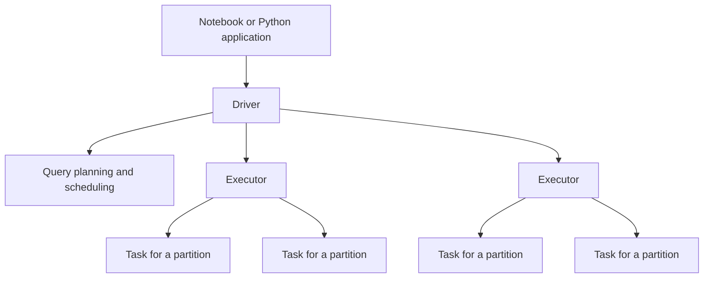
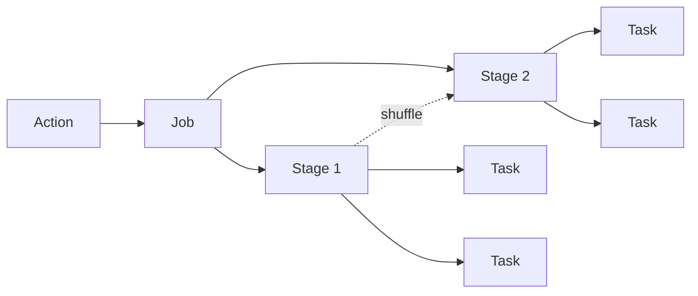

# Section 01 — Spark foundations

[← Course syllabus](../README.md) · [Open lab](LAB.ipynb) · [Section quiz](QUIZ.md) · [Next section →](../02-reading-data/README.md)

## Outcomes

After this section, you can explain the driver, executors, jobs, stages, tasks and partitions; distinguish transformations from actions; and describe what `local[2]` means.

## DataFrame API and literal SQL

Every exercise first builds a result with the DataFrame API and then reproduces it with literal SQL. A temporary view gives the in-memory DataFrame a name that SQL can use:

```python
people_df.createOrReplaceTempView("people")
spark.sql("SELECT person_id, name FROM people ORDER BY person_id").show()
```

The temporary view belongs to the current Spark session; it does not copy the data into a new file.

## Architecture



The **driver** runs the application, builds plans and coordinates execution. **Executors** perform tasks and can store cached partitions. In this course, `local[2]` uses two worker threads on one computer; it is not a two-node cluster.

## Execution vocabulary

| Term | Meaning |
|---|---|
| Partition | A unit of data processed by one task at a time |
| Transformation | Describes a new DataFrame without immediately producing a result |
| Action | Requires a result or side effect and can trigger a job |
| Job | Work initiated by an action |
| Stage | A set of tasks that can execute without crossing a shuffle boundary |
| Task | Work applied to one partition within a stage |
| Shuffle | Redistribution of records across partitions |

## Lazy evaluation

```python
adults = people.filter("age >= 18")
names = adults.select("name")
names.show()
```

The first two lines are transformations. `show()` is an action. Spark waits until an action requires a result and can then optimize the complete expression.

## Jobs, stages and tasks



One action can produce one or more jobs. A shuffle commonly separates stages. Each task processes one partition.

## Continue

Run [LAB.ipynb](LAB.ipynb), then complete [QUIZ.md](QUIZ.md).

