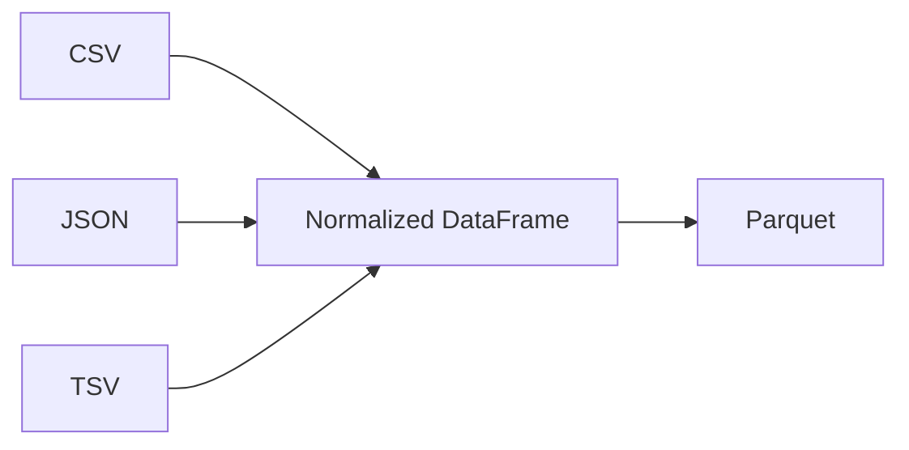

# Section 02 — Reading data

[← Previous section](../01-spark-foundations/README.md) · [Course syllabus](../README.md) · [Open lab](LAB.ipynb) · [Section quiz](QUIZ.md) · [Next section →](../03-dataframe-transformations/README.md)

## Outcomes

After this section, you can create a `SparkSession`, read CSV, TSV, JSON and Parquet, inspect schemas and counts, and explain why Spark output paths contain part files.

## DataFrame API and literal SQL

After a file is read into a DataFrame, register it as a temporary view and query the same rows with SQL:

```python
transactions.createOrReplaceTempView("transactions")
spark.sql("SELECT * FROM transactions LIMIT 5").show()
```

Each lab activity shows both routes so that schema and file-format behaviour can be compared without switching notebooks.

## Start a Spark session

```python
from pyspark.sql import SparkSession

spark = (
    SparkSession.builder
    .master("local[2]")
    .appName("pyspark-course")
    .config("spark.sql.shuffle.partitions", "4")
    .config("spark.sql.session.timeZone", "UTC")
    .getOrCreate()
)
```

Always inspect the active environment:

```python
print(spark.version)
print(spark.sparkContext.master)
```

## File readers

```python
csv_df = spark.read.option("header", True).csv("data/transactions.csv")
json_df = spark.read.json("data/products.json")
tsv_df = spark.read.option("header", True).option("sep", "\t").csv("data/products.tsv")
parquet_df = spark.read.parquet("output/products_parquet")
```

Use `printSchema()`, `show()` and `count()` to verify the result. Remember that `show()` and `count()` are actions.

## Default types, inferred types and explicit types

```python
# CSV columns remain strings unless a schema is supplied or inferred.
default_df = spark.read.option("header", True).csv(path)

# Spark examines the input and chooses types from the observed values.
inferred_df = (spark.read.option("header", True)
               .option("inferSchema", True)
               .csv(path))
```

`inferSchema=True` is convenient during exploration, but malformed or changing input can produce an unexpected type. Compare both schemas in the lab before using the explicit schema below.

## Explicit schemas

```python
from pyspark.sql.types import StructField, StructType, StringType

schema = StructType([
    StructField("transaction_id", StringType(), True),
    StructField("quantity", StringType(), True),
])
```

An explicit schema makes the expected columns and landing types clear. Reading potentially dirty numeric fields as strings allows validation to classify bad values later.

## Why Parquet

Parquet stores typed, columnar data. Spark can read only required columns and can often skip irrelevant row groups. A Parquet dataset is normally a directory containing part files because several tasks can write in parallel.



## Continue

Run [LAB.ipynb](LAB.ipynb), then complete [QUIZ.md](QUIZ.md).

