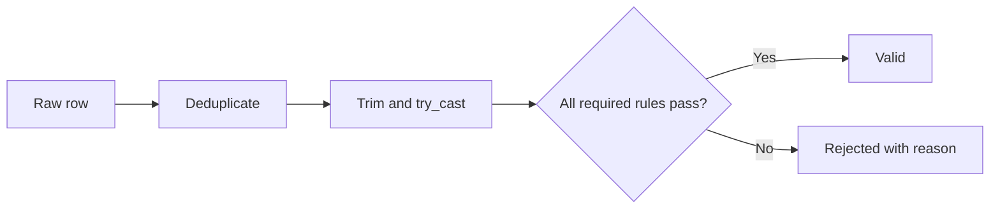

# Section 03 — DataFrames and data quality

[← Previous section](../02-reading-data/README.md) · [Course syllabus](../README.md) · [Open lab](LAB.ipynb) · [Section quiz](QUIZ.md) · [Next section →](../04-aggregations-and-sql/README.md)

## Outcomes

After this section, you can select, filter and derive columns; safely convert types; handle nulls and duplicates; and preserve rejected rows with reasons.

## DataFrames are immutable

Every transformation returns another DataFrame.

```python
from pyspark.sql import functions as F

selected = raw.select("transaction_id", "quantity", "status")
typed = selected.withColumn("qty", F.expr("try_cast(quantity as int)"))
completed = typed.filter(F.col("status") == "COMPLETED")
```

The original `raw` DataFrame remains unchanged.

## Essential transformations

```python
df.select("customer_id", "product_id")
df.filter(F.col("status") == "COMPLETED")
df.withColumn("line_total", F.col("qty") * F.col("price"))
df.dropDuplicates(["transaction_id"])
df.orderBy(F.desc("line_total"))
```

## Safe conversion

```python
typed = (
    raw
    .withColumn("order_date", F.expr("try_cast(transaction_date as date)"))
    .withColumn("qty", F.expr("try_cast(quantity as int)"))
    .withColumn("price", F.expr("try_cast(unit_price as decimal(12,2))"))
)
```

`try_cast` returns null for malformed text. The row can then be classified instead of terminating the complete job.

## Nulls and business meaning

Use `isNull()` and `isNotNull()` for null checks. Do not replace every missing value with zero or an empty string: a replacement must have a valid business meaning.

## Valid and rejected paths



```python
classified = typed.withColumn(
    "reject_reason",
    F.when(F.col("qty").isNull(), "invalid quantity")
     .when(F.col("qty") <= 0, "non-positive quantity")
     .otherwise("")
)
valid = classified.filter("reject_reason = ''")
rejected = classified.filter("reject_reason <> ''")
```

Keeping a rejection reason makes reconciliation and correction possible.

## Continue

Run [LAB.ipynb](LAB.ipynb), then complete [QUIZ.md](QUIZ.md).

