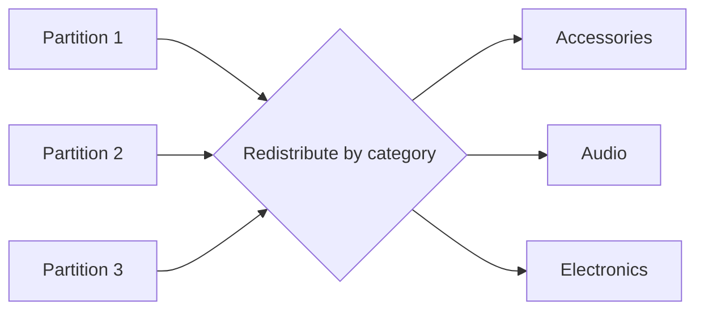

# Section 04 — Aggregations and Spark SQL

[← Previous section](../03-dataframes-and-quality/README.md) · [Course syllabus](../README.md) · [Open lab](LAB.ipynb) · [Section quiz](QUIZ.md) · [Next section →](../05-joins-and-parquet/README.md)

## Outcomes

After this section, you can define a business metric, create grouped summaries with the DataFrame API, query a temporary view with Spark SQL and reconcile both results.

## Define the metric first

For this course:

```text
line_total = qty × price

reported revenue = sum(line_total)
for completed, quality-valid and reference-matched transactions
```

A technically valid aggregation can still be wrong when its business filters are incomplete.

## DataFrame aggregation

```python
from pyspark.sql import functions as F

summary = (
    sales.groupBy("category")
    .agg(
        F.countDistinct("transaction_id").alias("orders"),
        F.sum("qty").alias("units"),
        F.sum("line_total").alias("revenue"),
    )
    .orderBy(F.desc("revenue"))
)
```

An aggregation changes the level of detail. Transaction rows become one row per category.

## Spark SQL

```python
sales.createOrReplaceTempView("sales")

summary_sql = spark.sql("""
    SELECT category,
           COUNT(DISTINCT transaction_id) AS orders,
           SUM(qty) AS units,
           SUM(line_total) AS revenue
    FROM sales
    GROUP BY category
    ORDER BY revenue DESC
""")
```

SQL and DataFrame expressions both become logical plans processed by Spark's optimizer.

## Why grouping shuffles



Rows with the same grouping key must reach the same output partition. This redistribution is a shuffle.

## Reconciliation

Compare category totals, overall revenue and row counts. Matching DataFrame and SQL outputs provide useful evidence, but both must also match the stated business definition.

## Continue

Run [LAB.ipynb](LAB.ipynb), then complete [QUIZ.md](QUIZ.md).

