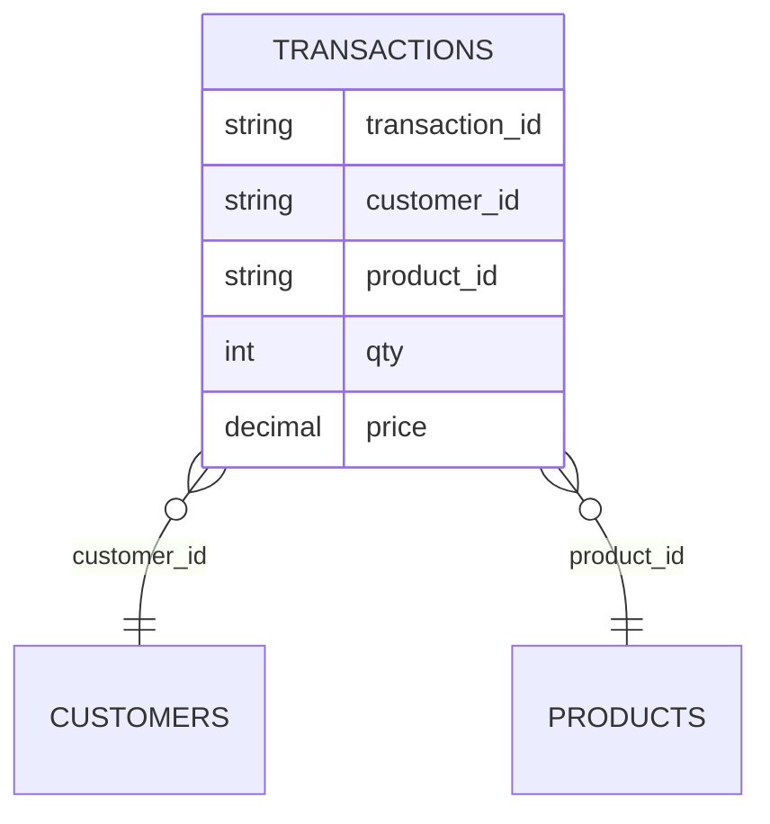

# Section 05 — Joins and Parquet output

[← Previous section](../04-aggregations-and-sql/README.md) · [Course syllabus](../README.md) · [Open lab](LAB.ipynb) · [Section quiz](QUIZ.md) · [Next section →](../06-execution-and-optimization/README.md)

## Outcomes

After this section, you can select a join type, identify unmatched keys, protect totals from duplicate reference keys and publish partitioned Parquet.

## Data relationships



Transactions hold business events. Customers and products provide descriptive reference attributes.

## Join choices

| Join | Result |
|---|---|
| Inner | Only matching rows |
| Left | Every left row plus matching right columns |
| Left anti | Only left rows without a match |
| Left semi | Matching left rows without adding right columns |

```python
unknown_products = transactions.join(products, "product_id", "left_anti")
enriched = transactions.join(products, "product_id", "inner")
```

Use a left or left-anti join to inspect missing references before an inner join removes them.

## Join multiplication

Reference keys must be unique. If one `product_id` occurs twice in the product table, one transaction can match twice and inflate later counts or revenue.

```python
duplicates = products.groupBy("product_id").count().filter("count > 1")
```

## Write partitioned Parquet

```python
(sales.write
 .mode("overwrite")
 .partitionBy("order_month")
 .parquet("output/curated_sales"))
```

```text
curated_sales/
├── order_month=2026-10/
│   ├── part-00000-....parquet
│   └── part-00001-....parquet
└── _SUCCESS
```

Read the destination back and verify schema, row count and business totals. Avoid partitioning by a nearly unique value such as transaction ID.

## Continue

Run [LAB.ipynb](LAB.ipynb), then complete [QUIZ.md](QUIZ.md).

