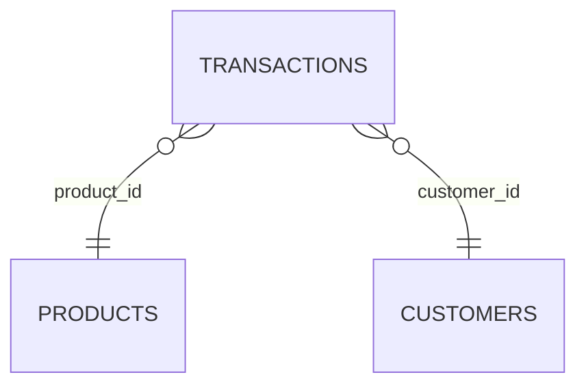

# Section 05 — Joins and Parquet output

[← Previous section](../04-aggregations-and-sql/README.md) · [Course syllabus](../README.md) · [Open lab](LAB.ipynb) · [Section quiz](QUIZ.md) · [Next section →](../06-advanced-dataframes-and-quality/README.md)

## Outcomes

After this section, you can explain and apply inner, left, right, full outer, left-semi and left-anti joins; check join-key uniqueness; and save a joined result as Parquet.

## DataFrame API and literal SQL

Every join is shown with both `DataFrame.join(...)` and a literal SQL join over temporary views. The paired queries use the same join keys and selected columns, making inner, left, right, full, left-semi and left-anti behaviour directly comparable.

## Join inputs



A join matches rows using one or more key columns.

## Inner join

Keeps keys present on both sides.

```python
matched = transactions.join(products, "product_id", "inner")
```

## Left and right joins

```python
all_transactions = transactions.join(products, "product_id", "left")
all_products = transactions.join(products, "product_id", "right")
```

- Left join preserves every left-side row.
- Right join preserves every right-side row.
- Missing columns from the other side contain null.

## Full outer join

```python
all_keys = transactions.join(products, "product_id", "full_outer")
```

Preserves unmatched rows from both sides.

## Left-semi and left-anti joins

```python
known = transactions.join(products, "product_id", "left_semi")
unknown = transactions.join(products, "product_id", "left_anti")
```

- Left-semi returns matching left rows without adding right-side columns.
- Left-anti returns only unmatched left rows.

## Join cardinality

Duplicate reference keys can multiply rows. Check uniqueness before using the joined result in a total:

```python
products.groupBy("product_id").count().filter("count > 1")
```

## Save and verify

```python
enriched.write.mode("overwrite").parquet("output/enriched_sales")
check = spark.read.parquet("output/enriched_sales")
```

Verify the schema and row count after reading the destination.

Complete [LAB.ipynb](LAB.ipynb), then answer [QUIZ.md](QUIZ.md).

