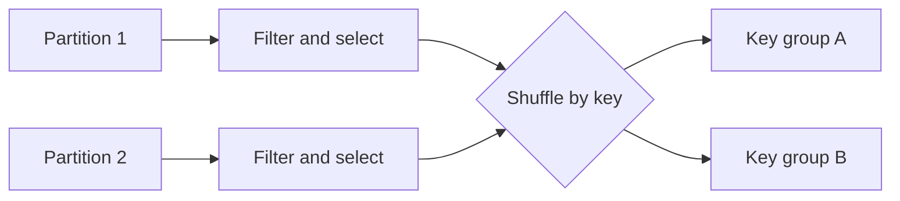

# Section 06 — Execution and practical optimization

[← Previous section](../05-joins-and-parquet/README.md) · [Course syllabus](../README.md) · [Open lab](LAB.ipynb) · [Section quiz](QUIZ.md) · [Project →](../07-guided-project/README.md)

## Outcomes

After this section, you can inspect a formatted plan, recognize scans, exchanges and join strategies, and apply common optimizations with a clear reason.

## Read the plan

```python
summary.explain("formatted")
```

| Plan element | Meaning |
|---|---|
| Scan | Source and columns being read |
| Filter / Project | Row and column operations |
| Exchange | Data redistribution across partitions |
| BroadcastHashJoin | A small input was distributed to workers |
| HashAggregate | Partial or final grouped aggregation |

## Narrow and wide operations



Filters and derived columns are commonly narrow. Grouping, sorting, distinct operations and many joins are wide because records move between partitions.

## Broadcast a small reference

```python
joined = facts.join(F.broadcast(products), "product_id", "left")
```

Broadcasting can avoid shuffling the larger side. It is appropriate only when the broadcast input fits comfortably in executor memory.

## Cache only reused work

```python
reused = expensive_result.cache()
reused.count()

report_a = reused.groupBy("category").count()
report_b = reused.groupBy("city").count()

reused.unpersist()
```

An action materializes the cache. Caching a DataFrame used once usually adds work instead of removing it.

## Practical optimization order

1. Confirm correctness and metric definitions.
2. Select required columns and apply useful filters early.
3. Prefer built-in Spark expressions to Python UDFs.
4. Inspect join strategies and exchanges.
5. Tune shuffle partitions for the real data volume and available resources.
6. Cache only reused, expensive results.
7. Control output file counts without forcing every result through one partition.
8. Measure again with representative data.

Adaptive Query Execution can adjust parts of a plan using runtime statistics, but it cannot repair incorrect keys, filters or metric definitions.

## Continue

Run [LAB.ipynb](LAB.ipynb), complete [QUIZ.md](QUIZ.md), then continue to the project.

