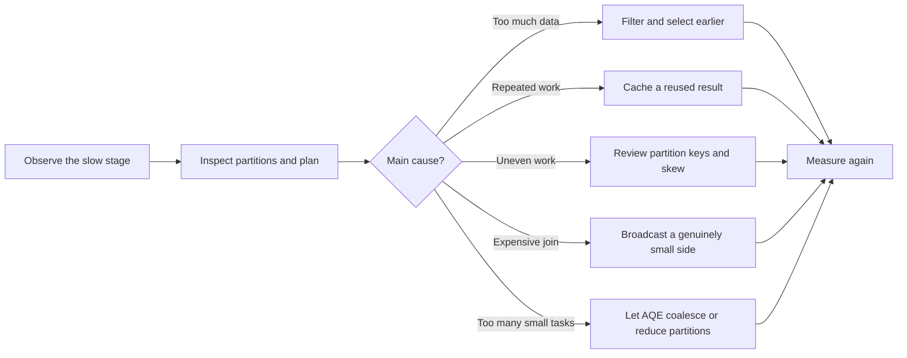
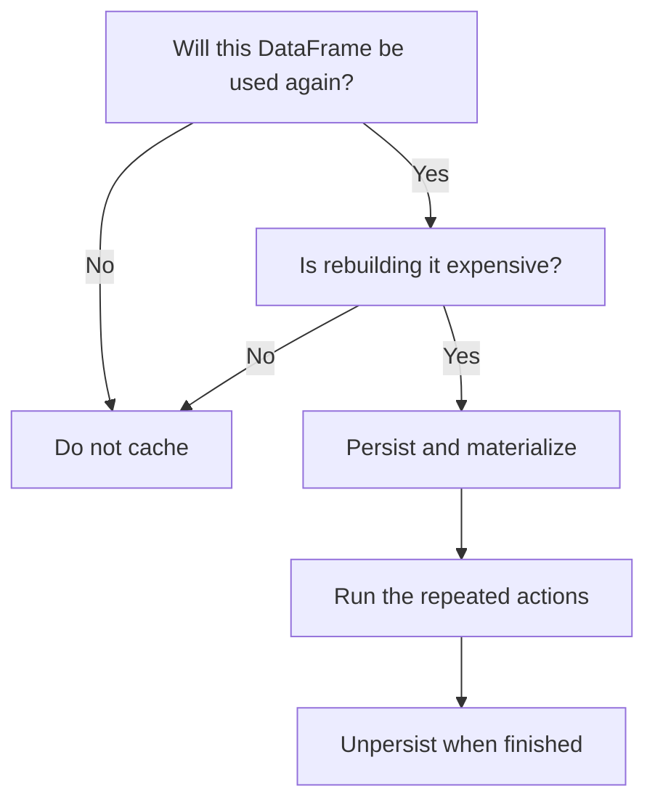
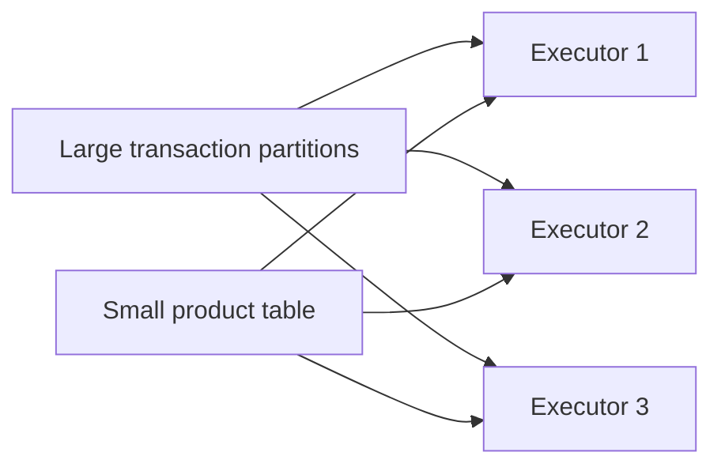

# Section 07 — Practical PySpark optimizations

[← Previous section](../06-advanced-dataframes-and-quality/README.md) · [Course syllabus](../README.md) · [Open guided demonstrations](GUIDED_DEMOS.ipynb) · [Knowledge check](QUIZ.md) · [Project →](../08-guided-project/README.md)

This is an instructor-led theory and demonstration section. There is no independent learner lab. Follow the examples, inspect the plans and ask what work Spark is trying to avoid.

## Outcomes

By the end of this section, you should be able to:

- explain partitions, tasks and shuffles in everyday language;
- choose between `repartition` and `coalesce`;
- decide when `cache` or `persist` is useful;
- describe how Adaptive Query Execution changes a plan at runtime;
- recognise broadcast joins, skew and repeated actions; and
- use `explain("formatted")` and the Spark UI before guessing at a tuning change.

## The optimization mindset

Optimization does not mean adding configuration until a job appears faster. It means finding where Spark spends time, then reducing unnecessary work without changing the result.



Keep three questions in mind:

1. How much data is Spark reading and moving?
2. Is the work distributed evenly?
3. Is Spark calculating the same result more than once?

## 1. Partitions: boxes of rows

Imagine a warehouse order divided into boxes. Spark can give different boxes to different workers. A **partition** is one such box of rows, and a task normally processes one partition in one stage.

- Too few partitions: some worker capacity remains unused.
- Too many tiny partitions: Spark spends too much time scheduling small tasks.
- Uneven partitions: one slow task can hold up the entire stage.

Check the current count:

```python
orders.rdd.getNumPartitions()
```

See where rows are located:

```python
from pyspark.sql import functions as F

(orders
 .withColumn("partition_id", F.spark_partition_id())
 .groupBy("partition_id")
 .count()
 .orderBy("partition_id")
 .show())
```

The best partition count depends on data size, cluster capacity and the work performed. There is no universal number that is correct for every job.

## 2. `repartition` and `coalesce`

Both methods change the number of partitions, but they solve different problems.

| Operation | Can increase partitions? | Can reduce partitions? | Usually performs a full shuffle? | Typical use |
|---|---:|---:|---:|---|
| `repartition(n)` | Yes | Yes | Yes | Rebalance data before expensive parallel work |
| `repartition(n, "key")` | Yes | Yes | Yes | Place matching keys together for later keyed work |
| `coalesce(n)` | No practical increase | Yes | No | Reduce partitions after a large filter before writing |

### Repartition example

```python
balanced = orders.repartition(8, "customer_id")
print(balanced.rdd.getNumPartitions())
```

`repartition` redistributes rows across the network. That shuffle costs time, so use it when the improved balance or required partitioning justifies the cost.

### Coalesce example

```python
small_result = filtered_orders.coalesce(2)
small_result.write.mode("overwrite").parquet(output_path)
```

`coalesce` combines existing partitions with less movement. It is useful after the data has become much smaller. Reducing everything to one partition can create a bottleneck and should not be a default habit.

## 3. Shuffles: moving rows between workers

A shuffle happens when rows must move so that related values meet in the same partition. Common shuffle-producing operations include:

- `groupBy` and `distinct`;
- joins where neither side is broadcast;
- `orderBy`;
- `repartition`; and
- many window operations.

Think of a shuffle as asking every warehouse worker to exchange boxes with other workers before work can continue. The exchange can involve network transfer, sorting and temporary disk files.

Shuffles are not automatically bad. Aggregations and joins often need them. The goal is to avoid **unnecessary** shuffles and keep the shuffled data as small as practical.

```python
summary = (orders
           .select("category", "revenue")
           .filter(F.col("revenue") > 0)
           .groupBy("category")
           .agg(F.sum("revenue").alias("revenue")))

summary.explain("formatted")
```

In a physical plan, an `Exchange` commonly marks repartitioning or shuffle work.

## 4. Cache and persist: keep a reusable intermediate result

Without caching, Spark can rebuild a DataFrame from its source and transformations for every action. Caching is like keeping a prepared ingredient on the counter because it will be used several times.

Use caching when all three are true:

1. the DataFrame is reused by multiple actions or downstream branches;
2. rebuilding it is meaningfully expensive; and
3. the cluster has enough storage memory or disk for the chosen level.

### Cache example

```python
clean_orders = expensive_cleaning(raw_orders).cache()

clean_orders.count()  # first action calculates and materializes the cache
clean_orders.groupBy("category").count().show()
clean_orders.groupBy("city").count().show()

clean_orders.unpersist()
```

`DataFrame.cache()` uses Spark's default DataFrame storage level. In Spark 4.1 this is `MEMORY_AND_DISK_DESER`.

### Persist example

`persist` makes the storage choice explicit:

```python
from pyspark import StorageLevel

reused = clean_orders.persist(StorageLevel.DISK_ONLY)
reused.count()
print(reused.storageLevel)
reused.unpersist()
```

| Storage choice | Plain-language meaning |
|---|---|
| `MEMORY_ONLY` | Keep what fits in memory; recompute missing partitions |
| `MEMORY_AND_DISK` | Keep in memory and spill partitions that do not fit to disk |
| `DISK_ONLY` | Store persisted partitions on disk |

Do not cache every DataFrame. A result used once gains no reuse benefit, and unnecessary caches compete for executor storage.



## 5. Adaptive Query Execution

**Adaptive Query Execution (AQE)** allows Spark SQL to revise parts of the physical plan after it has observed real runtime statistics.

Think of the initial query plan as a route chosen before a journey. AQE is the navigation system noticing actual traffic and changing the route while the journey is underway.

AQE can commonly:

- combine small post-shuffle partitions to avoid many tiny tasks;
- split skewed shuffle partitions so one task does not receive most of the work; and
- change a join strategy when runtime sizes show that a different strategy is more suitable.

AQE is enabled by default in Spark 4.1, but the demonstration sets the important options explicitly so they are visible:

```python
spark.conf.set("spark.sql.adaptive.enabled", "true")
spark.conf.set("spark.sql.adaptive.coalescePartitions.enabled", "true")
spark.conf.set("spark.sql.adaptive.skewJoin.enabled", "true")
```

Demonstrate the adaptive plan:

```python
adaptive_summary = (spark.range(0, 100_000, 1, 40)
                    .withColumn("group_id", F.col("id") % 10)
                    .groupBy("group_id")
                    .count())

adaptive_summary.collect()          # execute the query
adaptive_summary.explain("formatted")
```

Look for `AdaptiveSparkPlan` and compare the initial and final plan. A tiny local example teaches the mechanism; production decisions still require the Spark UI and realistic data volumes.

## 6. Broadcast joins

For a normal distributed join, Spark may need to shuffle both sides. If one side is genuinely small, Spark can copy it to each executor and avoid shuffling the large side.



```python
result = transactions.join(F.broadcast(products), "product_id", "left")
result.explain("formatted")
```

Look for `BroadcastHashJoin` in the physical plan. Broadcasting a large table can exhaust executor memory, so confirm its size instead of relying only on row count.

## 7. Data skew

Data is **skewed** when one or a few keys contain far more rows than the others. Most tasks finish quickly while one task works on the oversized partition.

```python
(orders.groupBy("customer_id")
 .count()
 .orderBy(F.desc("count"))
 .show(10))
```

Possible responses include:

- filtering invalid or unnecessary hot-key rows;
- pre-aggregating before a join;
- broadcasting the other side when it is safely small;
- relying on AQE skew handling where applicable; or
- deliberately salting a key as an advanced last resort.

Do not add salting before confirming skew. It makes logic more complex and is not needed for most joins.

## 8. Common low-risk optimizations

| Practice | Why it helps | Caution |
|---|---|---|
| Supply an explicit schema | Avoids repeated inference and prevents accidental types | The schema must match the source contract |
| Select only needed columns | Reduces data carried through later operations | Keep columns required by later rules |
| Filter early | Reduces rows before joins and aggregations | Preserve the intended business logic |
| Prefer built-in Spark expressions | Keeps work visible to Spark's optimizer | Use Python UDFs only when built-ins cannot express the rule |
| Broadcast a verified small dimension | Can avoid shuffling the large side | An oversized broadcast risks executor memory |
| Reuse one calculated result with cache | Avoids repeated lineage evaluation | Materialize it and later unpersist it |
| Avoid repeated diagnostic actions | Each `count`, `collect` or `show` can launch work | Keep only checks that add value |
| Avoid `collect()` on unknown data | Protects driver memory | Aggregate or limit before collecting |
| Inspect the physical plan | Reveals exchanges, join strategies and scans | A plan complements runtime measurements; it does not replace them |

### Built-in expression example

```python
# Visible to Spark's optimizer
clean = orders.withColumn("normalized_status", F.upper(F.trim("status")))
```

Prefer this to a Python UDF that only trims and uppercases text.

## 9. A sensible tuning sequence

1. Confirm that the result is correct.
2. Measure using the Spark UI, stage duration and realistic input.
3. Inspect the formatted physical plan.
4. Check input partition sizes and uneven task durations.
5. Reduce unneeded rows and columns.
6. Review shuffle operations and join strategies.
7. Cache only reused, expensive intermediates.
8. Change one important setting or design choice.
9. Run the same measurement again.

The fastest-looking local example is not proof of a production improvement. Cluster size, file sizes, key distribution and concurrent workloads all affect the outcome.

## Demonstration flow

The [guided demonstration notebook](GUIDED_DEMOS.ipynb) uses small DataFrames to show:

1. rows distributed across partitions;
2. `repartition` compared with `coalesce`;
3. cache and persist lifecycle;
4. broadcast join plans;
5. AQE configuration and adaptive plans; and
6. early selection, filtering and built-in expressions.

No output from this section is required for the project.

## Official references

- [Spark 4.1 SQL performance tuning](https://spark.apache.org/docs/4.1.0/sql-performance-tuning.html)
- [Spark 4.1 runtime configuration](https://spark.apache.org/docs/4.1.0/configuration.html)
- [PySpark 4.1 DataFrame implementation reference](https://spark.apache.org/docs/4.1.0/api/python/_modules/pyspark/sql/dataframe.html)

Continue to [Section 08 — Guided e-commerce pipeline](../08-guided-project/README.md).
