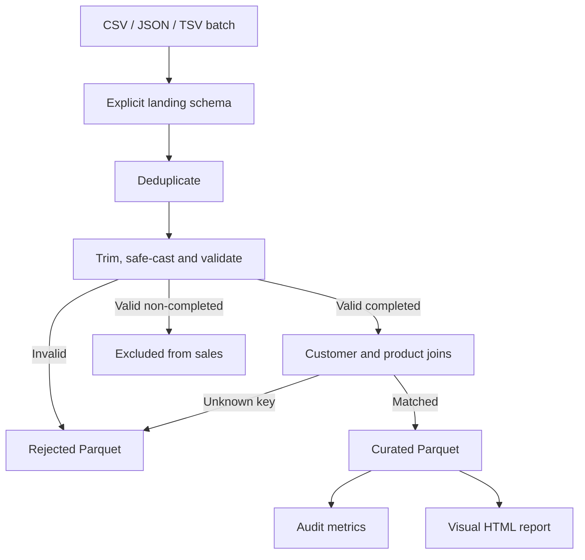

# Section 08 — Guided e-commerce pipeline

[← Previous section](../07-pyspark-optimizations/README.md) · [Course syllabus](../README.md) · [Open project lab](LAB.ipynb) · [Project review](QUIZ.md)

## DataFrame API and literal SQL

Each project stage runs through the DataFrame API and then repeats the same business logic with temporary views and literal SQL. Both routes validate the same accepted-row counts and revenue so that the completed pipeline is checked, not merely displayed.

## Goal

Build and run a repeatable batch pipeline that reads three source formats, validates transactions, joins reference data, writes partitioned Parquet and produces an audit and visual report for every run.

## Business rules

- A transaction ID is the within-batch duplicate key.
- Date, quantity and price must convert to their required types.
- Quantity must be positive and price must be non-negative.
- Customer and product IDs are required.
- Only `COMPLETED` transactions contribute to sales revenue.
- Completed transactions must match both reference tables.
- Invalid or unmatched rows are retained with a reason.

## Data contract

| Source field | Curated field | Rule |
|---|---|---|
| transaction_id | transaction_id | Required and deduplicated within the run |
| transaction_date | order_date | Valid date |
| customer_id | customer_id | Required and reference matched |
| product_id | product_id | Required and reference matched |
| quantity | qty | Positive integer |
| unit_price | price | Non-negative decimal |
| status | status | COMPLETED, CANCELLED or RETURNED |
| — | line_total | `qty × price` |
| — | order_month | Output partition derived from order date |

## Pipeline



## Source runs

| Run | Format | Scenario |
|---|---|---|
| run-001 | CSV | Initial batch |
| run-002 | JSON | Duplicate, malformed, missing and unmatched records |
| run-003 | TSV | Corrected records and new sales |

## Destination layout

```text
project/destination/
├── curated_sales/run_id=run-001/order_month=2026-10/
├── curated_sales/run_id=run-002/order_month=2026-10/
├── curated_sales/run_id=run-003/order_month=2026-10/
├── rejected_records/run_id=.../reject_stage=.../
└── audit/run_id=.../

project/reports/
├── run-001.html
├── run-002.html
├── run-003.html
└── all-runs.html
```

Each run overwrites only its own `run_id` path. Repeating run-002 must leave the combined accepted row count unchanged.

## Completion checks

| Run | Accepted sales | Rejected rows | Revenue |
|---|---:|---:|---:|
| run-001 | 10 | 0 | 41,383.00 |
| run-002 | 3 | 4 | 30,995.00 |
| run-003 | 8 | 0 | 31,435.00 |
| Combined | 21 | — | 103,813.00 |

Open [LAB.ipynb](LAB.ipynb) and run every cell in order. The notebook displays intermediate validation results, all run reports, the replay check and the final plan.

