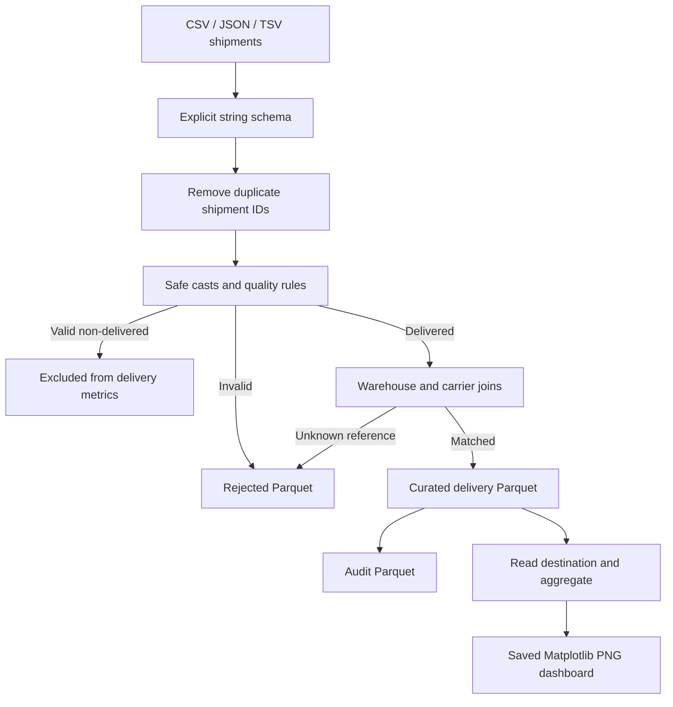

# Section 11 — Fulfilment analytics with Matplotlib reports

[← Previous section](../10-intermediate-pyspark-exercises/README.md) · [Course syllabus](../README.md) · [Open project notebook](LAB.ipynb) · [Project review](QUIZ.md)

## Goal

Build a repeatable e-commerce fulfilment pipeline that reads three source formats, validates shipment records, joins warehouse and carrier references, writes partitioned Parquet and saves a Matplotlib dashboard for every run.

## Source runs

| Run | Format | Scenario |
|---|---|---|
| run-001 | CSV | Valid October shipments with delivered, in-transit and cancelled records |
| run-002 | JSON | Duplicate, malformed, missing and unmatched records |
| run-003 | TSV | Valid November shipments with a different on-time pattern |

## Business rules

- `shipment_id` is the within-run duplicate key.
- Order, promised and delivered dates must convert safely.
- Shipping cost must be non-negative.
- Package weight must be positive.
- Status must be `DELIVERED`, `IN_TRANSIT` or `CANCELLED`.
- A delivered shipment must have a delivered date.
- Only delivered shipments contribute to fulfilment metrics.
- Delivered shipments must match both warehouse and carrier references.
- A shipment is on time when `delivered_date <= promised_date`.
- Invalid and unmatched records are retained with rejection reasons.

## Pipeline



## Curated fields

| Field | Meaning |
|---|---|
| `shipment_id` | Unique shipment within a run |
| `warehouse_name`, `warehouse_city` | Matched warehouse details |
| `carrier_name`, `service_type` | Matched carrier details |
| `order_date`, `promised_date`, `delivered_date` | Typed dates |
| `shipping_cost` | Decimal delivery cost |
| `package_weight` | Decimal package weight |
| `delay_days` | Delivered date minus promised date |
| `on_time` | `true` when delay is zero or negative |
| `delivery_month` | Destination partition derived from delivered date |

## Destination layout

```text
project/destination/
├── curated_shipments/run_id=run-001/delivery_month=2026-10/
├── curated_shipments/run_id=run-002/delivery_month=2026-10/
├── curated_shipments/run_id=run-003/delivery_month=2026-11/
├── rejected_records/run_id=.../reject_stage=.../
└── audit/run_id=.../

project/reports/
├── run-001-dashboard.png
├── run-002-dashboard.png
├── run-003-dashboard.png
└── all-runs-dashboard.png
```

Each run overwrites only its own run path. Repeating run-002 must not increase the combined curated count.

## Matplotlib dashboard

Each saved PNG is built from small aggregated results collected after the Parquet destination is read back. Spark performs the distributed aggregation; Matplotlib receives only the compact summary rows.

The dashboard contains:

- accepted shipment, on-time percentage and shipping-cost KPIs;
- on-time versus late shipment counts;
- average delay by carrier; and
- shipping cost by warehouse city.

```python
figure, axes = plt.subplots(2, 2, figsize=(12, 8))
# Add charts to the axes.
figure.tight_layout()
figure.savefig(report_path, dpi=150, bbox_inches="tight")
plt.close(figure)
```

Do not collect shipment-level data for plotting. Aggregate in Spark first and collect only the small chart result.

## DataFrame API and literal SQL

Every project stage contains the visible DataFrame implementation and a literal SQL validation route using temporary views. The SQL result is compared with the DataFrame result before the stage is complete.

## Expected results

| Run | Accepted | On time | Late | Rejected | Shipping cost |
|---|---:|---:|---:|---:|---:|
| run-001 | 6 | 4 | 2 | 0 | 855.00 |
| run-002 | 3 | 2 | 1 | 5 | 450.00 |
| run-003 | 6 | 3 | 3 | 0 | 985.00 |
| Combined | 15 | 9 | 6 | — | 2,290.00 |

## Completion checks

- All three source formats were processed.
- Invalid and unmatched rows have rejection reasons.
- Curated and rejected Parquet outputs are partitioned.
- Each audit matches `project/validation/expected_metrics.json`.
- Four PNG dashboards exist and are non-empty.
- Replaying run-002 leaves the combined accepted count at 15.

## Official reference

- [Matplotlib pyplot API](https://matplotlib.org/stable/api/pyplot_summary)

Open [LAB.ipynb](LAB.ipynb) and run every cell in order.
