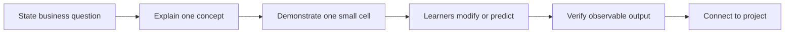
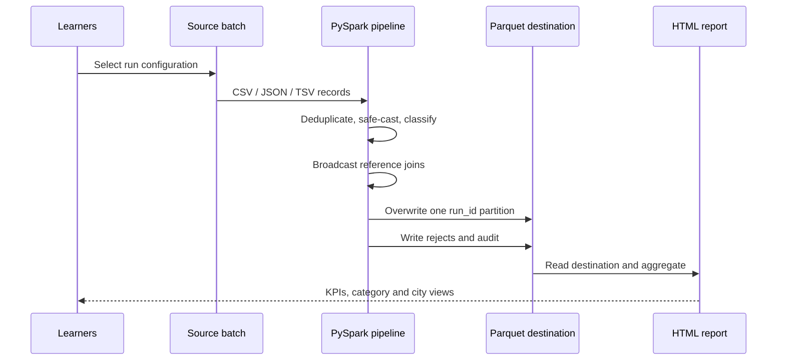

# Trainer delivery guide

## Workshop contract

**Audience:** Two learners with basic Python and SQL.  
**Session:** 6:30 AM–2:30 PM.  
**Breaks:** 15 minutes plus 45 minutes.  
**Delivery ratio:** Approximately 40% concept/demonstration and 60% hands-on work.  
**Outcome:** Each learner runs a three-batch PySpark pipeline and produces partitioned Parquet, rejection data, audit metrics, and visual HTML reports.

## Session flow

| Time | Section | Active method | Evidence |
|---|---|---|---|
| 6:30–6:45 | Welcome and cloned-environment check | Both learners run preflight | Spark 4.1.4 session and Parquet round-trip |
| 6:45–7:15 | Spark fundamentals | Architecture explanation + first actions | Learners distinguish driver, executor, job, stage, task, partition |
| 7:15–7:50 | Getting started | Read CSV, JSON, TSV and Parquet | Schemas and counts inspected |
| 7:50–8:50 | DataFrame fundamentals | Transform, cast, filter, null and duplicate exercises | Clean and rejected frames |
| 8:50–9:05 | Break | — | — |
| 9:05–9:50 | Aggregations and Spark SQL | Equivalent DataFrame and SQL summaries | Reconciled revenue result |
| 9:50–10:35 | Joins and saving | Inner/left/anti joins, Parquet output | Matched and unmatched keys identified |
| 10:35–11:05 | Execution and practical optimization | Plans, shuffle, broadcast, cache, partitions | Learners locate exchanges and broadcast joins |
| 11:05–11:50 | Meal break | — | — |
| 11:50–2:20 | Fully guided multi-run project | One pipeline, three batches, reports and replay | 3 audits + 4 HTML reports + partitioned Parquet |
| 2:20–2:30 | Knowledge check and closure | Oral/written check | Learners explain the completed pipeline |

Total elapsed time: **480 minutes**. Active learning: **420 minutes**. Breaks: **60 minutes**.

## Teaching rhythm

Use the same rhythm in every foundation section:

With only two participants, have them alternate roles:

- **Driver:** types and explains what the code should do.
- **Reviewer:** predicts schema/count/plan and checks the result.
- Swap roles at every module and after every project run.

## Section guidance

### 1. Environment and orientation

- Do not install during teaching time. Run validation before 6:30 AM.
- Confirm `spark.version`, Python executable, Java version, master and writable output folder.
- Set expectations: local mode teaches the same DataFrame model but is not a multi-node cluster.
- Introduce the shared e-commerce story: ingest, validate, enrich, summarize, publish.

### 2. Spark fundamentals

- Use the architecture diagrams in the presentation.
- Contrast Spark with single-process Python without claiming Spark is always faster.
- Make transformations versus actions concrete by checking when a job appears.
- Ask each learner to name the driver responsibility and task input.

### 3. Files and DataFrames

- Show why explicit schemas are preferable for stable pipelines.
- Read the same logical transaction contract from multiple formats.
- Emphasize that a Spark output “file” is normally a directory of part files.
- Let learners inspect schemas before they transform anything.

### 4. Data quality

- Treat malformed values, missing required fields and bad business keys separately.
- Preserve rejected records with a reason; do not silently discard them.
- Use `try_cast` for intentionally dirty training fields under ANSI behavior.
- Keep cancelled/returned transactions valid but outside completed-sales reporting.

### 5. Aggregations and SQL

- Define revenue before writing code.
- Implement one summary with both DataFrame API and Spark SQL.
- Point out that equivalent logical operations can receive equivalent optimized plans.
- Reconcile totals rather than accepting an attractive chart as proof.

### 6. Joins and output

- Frame transactions as a fact-like dataset and customers/products as small dimensions.
- Demonstrate left-anti joins for orphan keys.
- Warn that duplicate dimension keys can multiply rows and revenue.
- Read Parquet back and validate the count/schema immediately after writing.

### 7. Practical optimization

Cover the optimizations learners will use most often:

| Technique | Teaching point |
|---|---|
| Explicit schema | Avoid repeated inference and stabilize types |
| Select/filter early | Enable column and predicate pruning where supported |
| Broadcast small dimensions | Avoid a large shuffle join when the table is truly small |
| Inspect `explain("formatted")` | Look for exchanges, scans and join choices |
| AQE | Runtime plan adjustment helps, but does not replace sound design |
| Cache reused expensive frames | Materialize deliberately and `unpersist()` afterward |
| Sensible shuffle partitions | Tune for data and cluster size, not a copied magic number |
| Avoid unnecessary actions | Each `count`, `collect` or write can trigger work |
| Avoid Python UDFs for built-ins | Keep expressions visible to Spark's optimizer |
| Control output partitions | Avoid thousands of tiny files and avoid habitual `coalesce(1)` |

Do not attempt exhaustive optimization coverage. Keep cluster sizing, skew tuning, bucketing, streaming and advanced Spark UI analysis as follow-up topics.

## Guided project flow

Use `project-notebooks/07_guided_project_starter.ipynb`.

### Run checkpoints

| Run | Format | Scenario | Expected accepted | Expected rejected | Revenue |
|---|---|---|---:|---:|---:|
| run-001 | CSV | Clean initial batch | 10 | 0 | 41,383.00 |
| run-002 | JSON | Duplicate, malformed, missing and unmatched | 3 | 4 | 30,995.00 |
| run-003 | TSV | Corrected records plus new sales | 8 | 0 | 31,435.00 |
| Combined | Parquet | Destination across all runs | 21 | — | 103,813.00 |

The run-002 duplicate is counted in the audit but is not a rejected record because its identical copy is removed before validation. Cancelled and returned rows are valid, non-completed business events; they are neither accepted sales nor rejects.

### Replay demonstration

After all three runs, record the destination count, rerun `run-002`, and recount. Both counts must be 21. Explain the boundary: replacing one known batch partition provides same-batch idempotency, but file-based Parquet does not provide general transactions or concurrent upserts.

## Facilitation and recovery

| Situation | Response |
|---|---|
| One learner's kernel fails | Pair on the working clone; troubleshoot during a break |
| 15 minutes behind | Reduce foundation exercise variants, not project runs |
| 30 minutes behind | Demonstrate run-001, jointly inspect run-002, then execute run-003 compactly |
| Different totals | Check status filter, duplicate removal, casting, unmatched keys and join uniqueness |
| Many tiny output files | Relate task/partition count to files; do not force one file as a universal fix |
| Report is blank | Verify accepted count, then read the exact destination run partition |
| Mermaid unsupported | Use the adjacent prose and tables; do not debug the renderer during class |

## Completion checklist

- [ ] Both participants started the cloned environment successfully.
- [ ] Each participant ran or reviewed all six foundation notebooks.
- [ ] Three source formats were processed.
- [ ] Quality and reference rejects were inspected.
- [ ] Three audit partitions matched expected metrics.
- [ ] Three run reports and one combined report rendered.
- [ ] A replay kept the accepted destination count stable.
- [ ] Learners identified a shuffle and a broadcast join in a plan.
- [ ] Knowledge check was completed.

