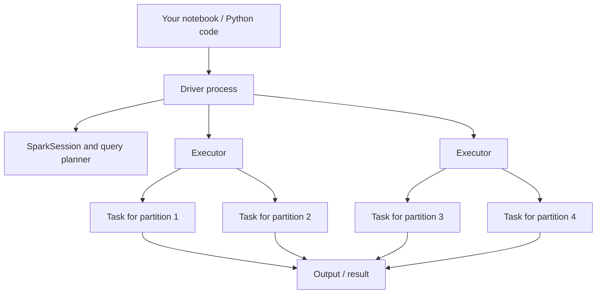
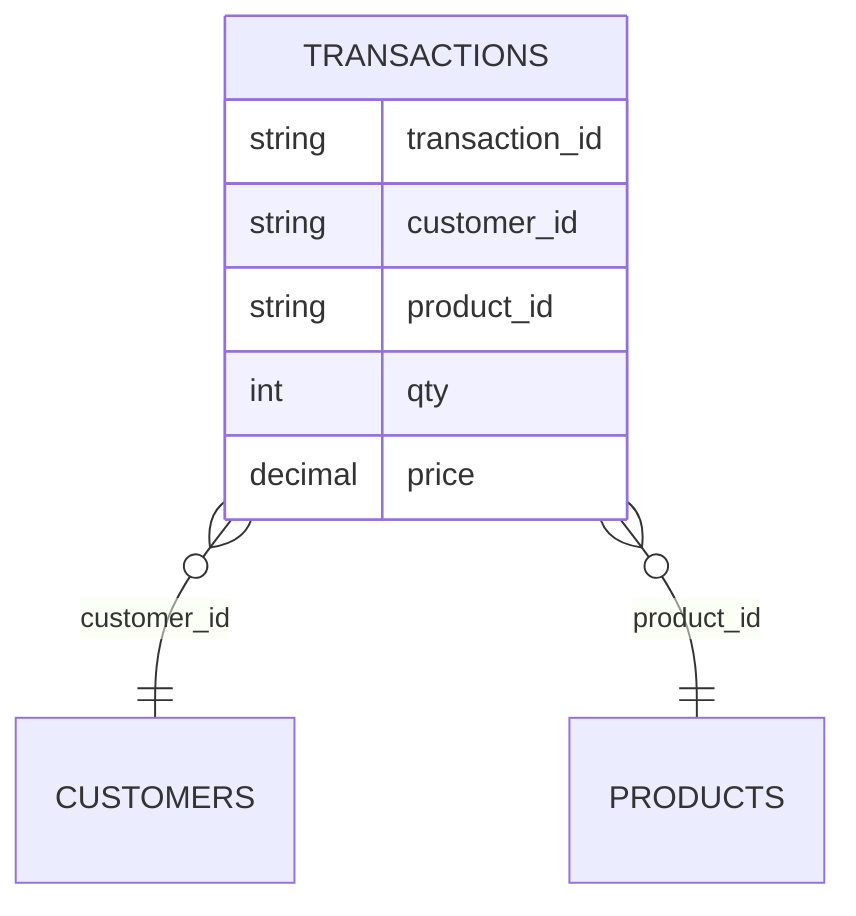
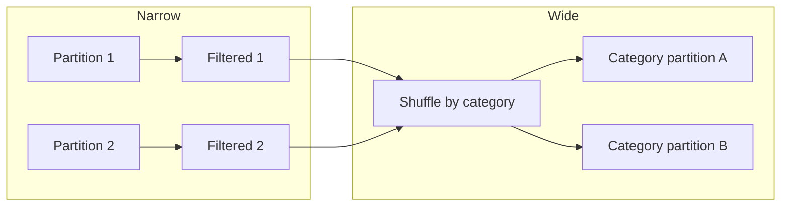

# Apache Spark fundamentals with PySpark

## Learning outcomes

By the end of the workshop, you can:

- Explain Spark's driver, executors, jobs, stages, tasks and partitions.
- Build a local `SparkSession` and read CSV, JSON, TSV and Parquet.
- Use DataFrame transformations to select, filter, derive, cast and validate data.
- Aggregate with the DataFrame API and Spark SQL.
- Join reference data and diagnose unmatched keys.
- Write and read partitioned Parquet.
- Inspect a physical plan and apply practical optimizations.
- Run an audited three-batch e-commerce pipeline and verify its reports.

## 1. The Spark mental model

Spark is a distributed processing engine. PySpark is its Python interface. Your Python program describes transformations; Spark builds a plan and executes work when an action requires a result.



In this workshop, `local[2]` uses two worker threads on one computer. It demonstrates the programming and execution model, but it is not a multi-node cluster.

### Vocabulary

| Term | Practical meaning |
|---|---|
| Driver | Runs your Python application, creates plans and coordinates work |
| Executor | Runs tasks and can hold cached partitions |
| Partition | A unit of distributed data handled by one task at a time |
| Transformation | Describes a new DataFrame, such as `filter` or `select` |
| Action | Requires a result or side effect, such as `count`, `collect` or `write` |
| Job | Work triggered by an action |
| Stage | Tasks that can run without crossing a shuffle boundary |
| Shuffle | Redistribution of records across partitions |

### Lazy evaluation

```python
adults = people.filter(F.col("age") >= 18)  # plan only
names = adults.select("name")                # plan only
names.show()                                 # action: Spark executes
```

Lazy evaluation lets Spark optimize the complete expression before it runs.

## 2. Starting a session and reading data

```python
from pyspark.sql import SparkSession

spark = (
    SparkSession.builder
    .master("local[2]")
    .appName("pyspark-workshop")
    .config("spark.sql.shuffle.partitions", "4")
    .config("spark.sql.session.timeZone", "UTC")
    .getOrCreate()
)
```

Check the real environment rather than trusting a document:

```python
import sys
print(spark.version)
print(sys.version)
print(spark.sparkContext.master)
```

### File readers

```python
csv_df = spark.read.option("header", True).csv("data/transactions.csv")
json_df = spark.read.json("data/products.json")
tsv_df = spark.read.option("header", True).option("sep", "\t").csv("data/products.tsv")
parquet_df = spark.read.parquet("output/sales")
```

For a stable pipeline, supply a schema:

```python
from pyspark.sql.types import StructType, StructField, StringType

schema = StructType([
    StructField("transaction_id", StringType(), True),
    StructField("quantity", StringType(), True),
])
df = spark.read.schema(schema).option("header", True).csv(path)
```

Landing messy values as strings allows you to classify casting failures instead of failing during the read.

## 3. DataFrame fundamentals

DataFrames are immutable. Each transformation returns another DataFrame.

```python
from pyspark.sql import functions as F

selected = df.select("transaction_id", "status", "quantity")
completed = selected.filter(F.col("status") == "COMPLETED")
typed = completed.withColumn("qty", F.expr("try_cast(quantity as int)"))
```

### Common operations

```python
df.select("customer_id", "product_id")
df.filter((F.col("status") == "COMPLETED") & (F.col("qty") > 0))
df.withColumn("line_total", F.col("qty") * F.col("price"))
df.withColumnRenamed("transaction_date", "order_date_text")
df.drop("unused_column")
df.dropDuplicates(["transaction_id"])
df.orderBy(F.desc("line_total"))
```

### Null logic

Use null-aware expressions:

```python
df.filter(F.col("customer_id").isNull())
df.filter(F.col("customer_id").isNotNull())
df.fillna({"city": "UNKNOWN"})
```

Do not automatically replace every null with zero or an empty string. A replacement must match the business meaning.

### Quality classification

Keep a reason with rejected data:

```python
classified = df.withColumn(
    "reject_reason",
    F.when(F.col("qty").isNull(), "invalid quantity")
     .when(F.col("qty") <= 0, "non-positive quantity")
     .otherwise("")
)
valid = classified.filter(F.col("reject_reason") == "")
rejected = classified.filter(F.col("reject_reason") != "")
```

## 4. Aggregation and Spark SQL

Define the metric before writing code. In this workshop:

```text
line_total = quantity × unit_price
reported revenue = sum(line_total) for completed, quality-valid, reference-matched rows
```

### DataFrame API

```python
summary = (
    sales.groupBy("category")
    .agg(
        F.countDistinct("transaction_id").alias("orders"),
        F.sum("qty").alias("units"),
        F.sum("line_total").alias("revenue"),
    )
    .orderBy(F.desc("revenue"))
)
```

### Spark SQL

```python
sales.createOrReplaceTempView("sales")
summary_sql = spark.sql("""
    SELECT category,
           COUNT(DISTINCT transaction_id) AS orders,
           SUM(qty) AS units,
           SUM(line_total) AS revenue
    FROM sales
    GROUP BY category
    ORDER BY revenue DESC
""")
```

Spark SQL and the DataFrame API both produce logical plans handled by Spark's optimizer.

## 5. Joins and reference integrity



### Join choices

| Join | Use in the workshop |
|---|---|
| Inner | Keep only matched records |
| Left | Preserve transactions and expose missing reference values |
| Left anti | Return only transactions without a reference match |
| Left semi | Return matching left records without adding right columns |

```python
enriched = transactions.join(customers, "customer_id", "left")
orphans = transactions.join(customers, "customer_id", "left_anti")
```

Validate that reference keys are unique. If a product identifier appears twice in the reference table, one transaction can become two joined rows and inflate revenue.

## 6. Writing Parquet

```python
(sales.write
 .mode("overwrite")
 .partitionBy("order_month")
 .parquet("destination/curated_sales"))
```

Parquet is columnar, typed and supports column pruning and predicate pushdown. Spark writes a dataset directory containing part files and metadata.

### Partition layout

```text
curated_sales/
├── run_id=run-001/
│   └── order_month=2026-10/part-....parquet
└── run_id=run-002/
    └── order_month=2026-10/part-....parquet
```

Partition by columns commonly used to restrict reads and with a sensible number of distinct values. Do not partition by a nearly unique transaction ID.

## 7. Execution and practical optimization

### Read the plan

```python
summary.explain("formatted")
```

Look for:

- `Scan`: what data and columns are read.
- `Filter` and `Project`: pushed or early operations.
- `Exchange`: a shuffle boundary.
- `BroadcastHashJoin`: one side was distributed to executors.
- `HashAggregate`: aggregation, often around an exchange.

### Narrow and wide work



Filters and derived columns are commonly narrow. `groupBy`, `distinct`, `orderBy` and many joins commonly require a shuffle.

### Optimization checklist

1. Read only required columns and filter early.
2. Use Spark built-in expressions before Python UDFs.
3. Broadcast a genuinely small dimension when appropriate.
4. Cache only an expensive DataFrame that will be reused.
5. Materialize a cache with an action, then call `unpersist()` when finished.
6. Choose shuffle partitions based on data volume and available parallelism.
7. Avoid repeated `count()` and `collect()` calls in production paths.
8. Avoid habitual `coalesce(1)`; it removes parallel output.
9. Inspect the plan and Spark UI before guessing at a bottleneck.
10. Treat tiny training data as a concept demonstration, not a benchmark.

## 8. Guided three-run project

The project normalizes three file formats into one contract:

| Run | Input | Main lesson |
|---|---|---|
| run-001 | CSV | Clean baseline and destination write |
| run-002 | JSON | Duplicate, malformed values and unknown keys |
| run-003 | TSV | Corrected records and new transactions |

Open `project-notebooks/07_guided_project_starter.ipynb`. The notebook walks through every stage, runs all three batches, replays run-002, validates audit metrics and displays four visual reports.

### Why batch partition overwrite is useful

Writing each batch to `run_id=...` and overwriting only that path prevents an identical replay from appending a second copy. This is a scoped idempotency pattern, not a replacement for transactional storage.

## 9. Common mistakes

| Mistake | Consequence | Better approach |
|---|---|---|
| Inferring every CSV schema | Unstable types and extra read work | Declare the expected landing schema |
| Plain cast on dirty text | ANSI casting exception | Use `try_cast`, classify and retain rejects |
| Inner join immediately | Orphan keys disappear silently | Use left/anti diagnostics first |
| Caching everything | Memory pressure and extra materialization | Cache reused expensive frames only |
| Calling `collect()` on large data | Driver memory failure | Aggregate or limit before collecting |
| Assuming local mode is a cluster | Incorrect operational expectations | State the execution environment explicitly |
| Writing one file | Bottleneck and lost parallelism | Write a sensible number of partition files |
| Trusting a chart without reconciliation | Attractive but incorrect report | Validate counts and totals at every stage |

## Further study

After this workshop, continue with Spark UI analysis, testing, structured streaming, cluster deployment, skew handling, orchestration, and a transactional lakehouse table format when the use case requires it.

