# Apache Spark Fundamentals

## PySpark industry workshop

**Two learners · Seven active hours · Hands-on local Spark**

<br>

Final outcome: CSV + JSON + TSV → validated and enriched Parquet → audit and visual reports

---

# What you will build

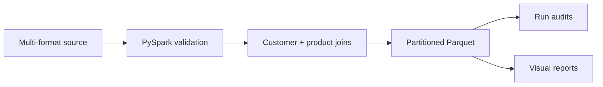

- Three independently auditable batch runs
- Preserved quality and reference rejects
- Replay-safe `run_id` partitions
- Reports produced from destination data

---

# Learning journey

| Foundation | Application |
|---|---|
| Spark architecture | One repeatable pipeline |
| DataFrames and schemas | Three input formats |
| Quality rules | Reject records with reasons |
| Aggregations and SQL | Revenue reports |
| Joins | Customer/product enrichment |
| Plans and optimization | Broadcast, shuffle, cache and partitions |

---

# When Spark is useful

Spark is a good fit when:

- Data or computation benefits from parallel work.
- A shared engine should support SQL, batch, streaming or ML workloads.
- You need a scalable DataFrame execution model.

Spark may be unnecessary when:

- The data comfortably fits a simpler tool.
- Startup and distributed coordination cost exceed the work.
- A transactional row-by-row application database is the real requirement.

---

# Architecture

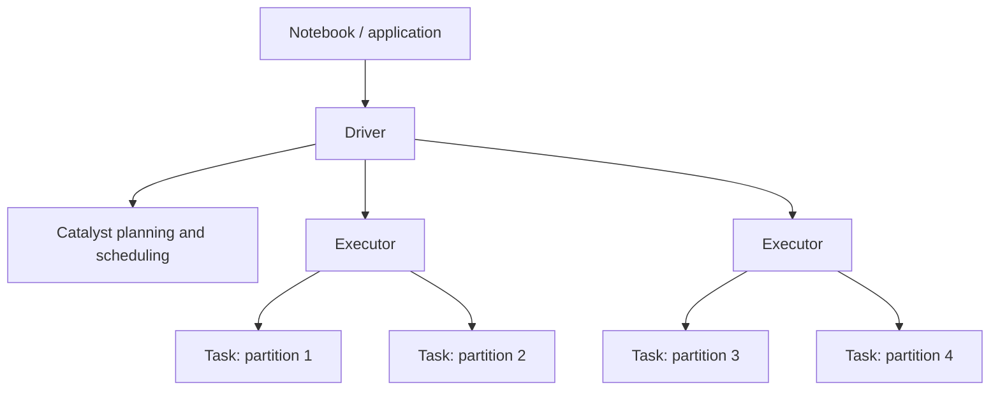

**Workshop nuance:** `local[2]` means one computer and two worker threads.

---

# Jobs, stages, tasks and partitions

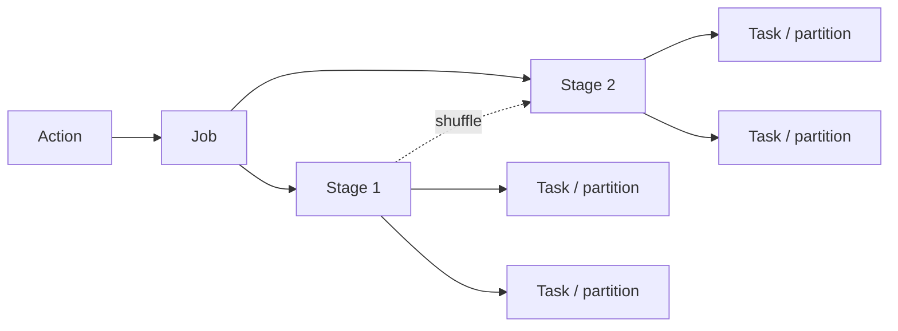

One task processes one partition at a time. A shuffle commonly separates stages.

---

# Lazy evaluation

```python
completed = transactions.filter("status = 'COMPLETED'")
summary = completed.groupBy("category").sum("line_total")

# No result required yet
summary.show()  # action triggers a job
```

Why it matters:

- Spark can optimize the full expression.
- Unused branches need not execute.
- Repeated actions can repeat work unless results are reused appropriately.

---

# Start and verify Spark

```python
spark = (
    SparkSession.builder
    .master("local[2]")
    .appName("workshop")
    .config("spark.sql.shuffle.partitions", "4")
    .getOrCreate()
)

print(spark.version)
print(spark.sparkContext.master)
```

Verify the real runtime, not just the installation notes.

---

# One logical contract, several formats

| Source | Reader |
|---|---|
| CSV | `spark.read.option("header", True).csv(path)` |
| TSV | Add `.option("sep", "\t")` |
| JSON Lines | `spark.read.json(path)` |
| Parquet | `spark.read.parquet(path)` |

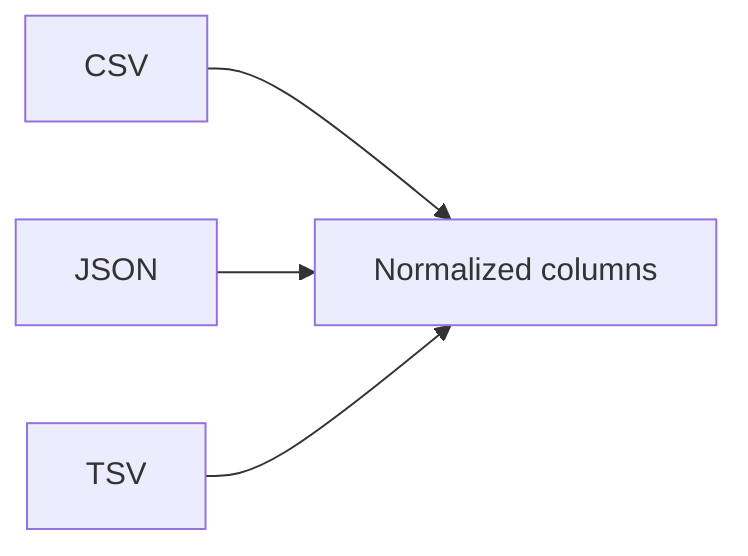

---

# Why explicit schemas matter

```python
schema = """
transaction_id string,
transaction_date string,
customer_id string,
product_id string,
quantity string,
unit_price string,
status string
"""

raw = spark.read.schema(schema).option("header", True).csv(path)
```

- Stable contract
- No repeated inference scan
- Dirty values remain observable for classification

---

# DataFrames are immutable

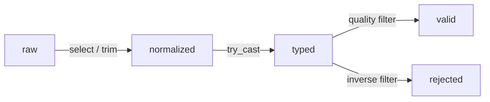

Each transformation produces a new logical DataFrame.

---

# Essential transformations

```python
from pyspark.sql import functions as F

result = (
    raw
    .dropDuplicates(["transaction_id"])
    .withColumn("status", F.upper(F.trim("status")))
    .withColumn("qty", F.expr("try_cast(quantity as int)"))
    .filter(F.col("qty") > 0)
    .select("transaction_id", "status", "qty")
)
```

Predict the schema before running `printSchema()`.

---

# Null is not zero

```text
missing quantity ≠ zero quantity
unknown customer ≠ empty customer
invalid date ≠ today's date
```

```python
df.filter(F.col("customer_id").isNull())
```

Replacements need a documented business meaning.

---

# Preserve rejected records

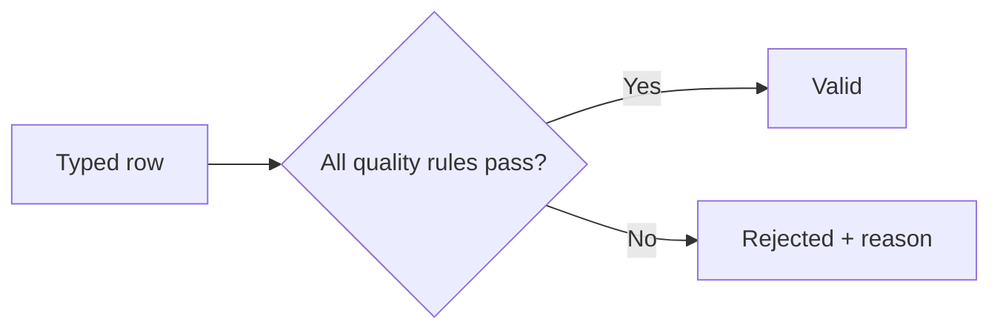

Examples:

- `invalid transaction_date`
- `quantity must be a positive integer`
- `missing product_id`
- `unknown customer_id`

Silent dropping prevents reconciliation and repair.

---

# Define revenue before coding

```text
line_total = qty × price

reported revenue = Σ line_total
where status = COMPLETED
and quality rules pass
and customer and product keys match
```

The metric definition is part of the pipeline contract.

---

# DataFrame aggregation

```python
summary = (
    sales.groupBy("category")
    .agg(
        F.countDistinct("transaction_id").alias("orders"),
        F.sum("qty").alias("units"),
        F.sum("line_total").alias("revenue"),
    )
)
```

`groupBy` commonly causes a shuffle because equal keys must meet.

---

# Equivalent Spark SQL

```sql
SELECT category,
       COUNT(DISTINCT transaction_id) AS orders,
       SUM(qty) AS units,
       SUM(line_total) AS revenue
FROM sales
GROUP BY category
ORDER BY revenue DESC
```

SQL and DataFrame expressions both become Spark logical plans.

---

# Transaction and reference relationships

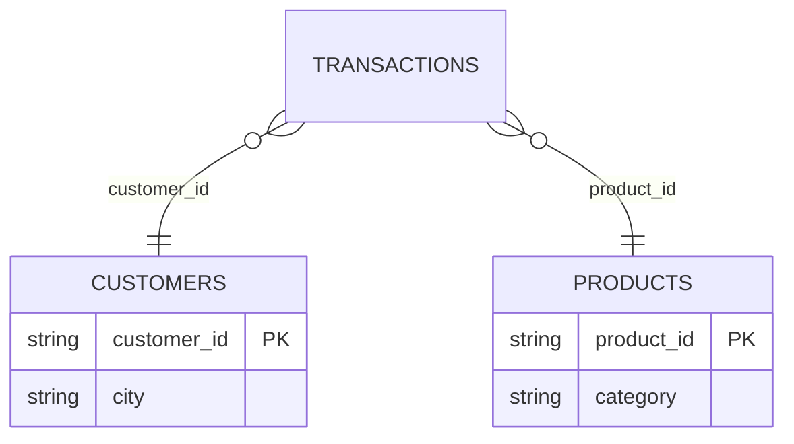

Validate the `PK` assumption before trusting joined totals.

---

# Join selection

| Join | Question answered |
|---|---|
| Inner | Which transactions have matching references? |
| Left | What reference information exists for every transaction? |
| Left anti | Which transaction keys are missing from the reference? |
| Left semi | Which left-side rows have a match? |

```python
orphans = transactions.join(products, "product_id", "left_anti")
```

---

# Parquet destination

```python
(sales.write
 .mode("overwrite")
 .partitionBy("order_month")
 .parquet(output_path))
```

```text
curated_sales/
└── run_id=run-001/
    └── order_month=2026-10/
        ├── part-00000-....parquet
        └── part-00001-....parquet
```

A Spark dataset path is normally a directory, not one file.

---

# Read the plan

```python
summary.explain("formatted")
```

Look for:

| Plan element | Meaning |
|---|---|
| Scan | Source and selected columns |
| Filter / Project | Row and column operations |
| Exchange | Shuffle boundary |
| BroadcastHashJoin | Small side distributed to workers |
| HashAggregate | Partial/final aggregation |

---

# Narrow versus wide

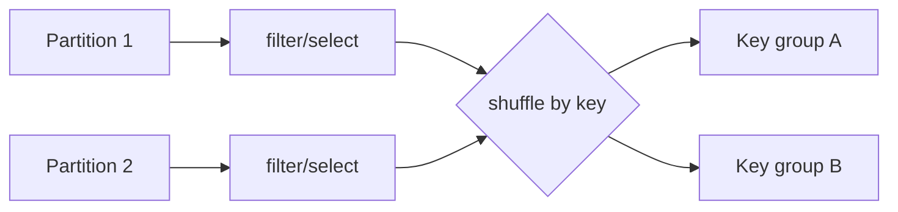

Narrow operations retain partition locality. Wide operations redistribute data.

---

# Practical optimization order

1. Confirm correctness and metric definitions.
2. Inspect scan, filters, columns and join strategy.
3. Reduce unnecessary data early.
4. Broadcast truly small reference data.
5. Tune shuffle partitions for the workload.
6. Cache only reused expensive results.
7. Control output file sizes and counts.
8. Measure again with representative data.

Optimization without measurement is guesswork.

---

# Cache with intent

```python
reused = expensive_transform.cache()
reused.count()       # materialize

report_a = reused.groupBy("category").count()
report_b = reused.groupBy("city").count()

reused.unpersist()
```

Caching is useful only when reuse benefit exceeds materialization and memory cost.

---

# Adaptive Query Execution

AQE can adjust parts of a query using runtime statistics.

```python
spark.conf.get("spark.sql.adaptive.enabled")
```

AQE can help with choices such as partition coalescing and join behavior. It does not repair incorrect logic, poor keys or unbounded driver collection.

---

# Project source runs

| Run | Format | Scenario |
|---|---|---|
| run-001 | CSV | Clean initial batch |
| run-002 | JSON | Duplicate, malformed, missing and unmatched records |
| run-003 | TSV | Corrected records plus new sales |

Same logical columns. Different physical formats and data conditions.

---

# Project pipeline

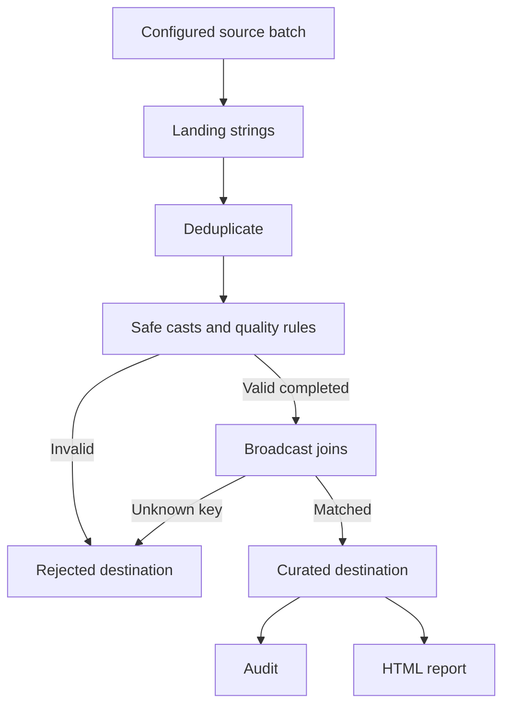

---

# Audit equations

```text
raw - duplicates = unique
unique - quality rejected = valid
valid - non-completed = completed
completed - reference rejected = accepted sales
```

Run 2 expected result:

| Raw | Duplicate | Quality reject | Reference reject | Accepted |
|---:|---:|---:|---:|---:|
| 10 | 1 | 2 | 2 | 3 |

---

# Three run outcomes

| Run | Accepted | Rejected | Revenue |
|---|---:|---:|---:|
| run-001 | 10 | 0 | 41,383.00 |
| run-002 | 3 | 4 | 30,995.00 |
| run-003 | 8 | 0 | 31,435.00 |
| Combined | 21 | — | 103,813.00 |

Duplicates and non-completed events have separate audit meanings.

---

# Replay behavior without Delta Lake

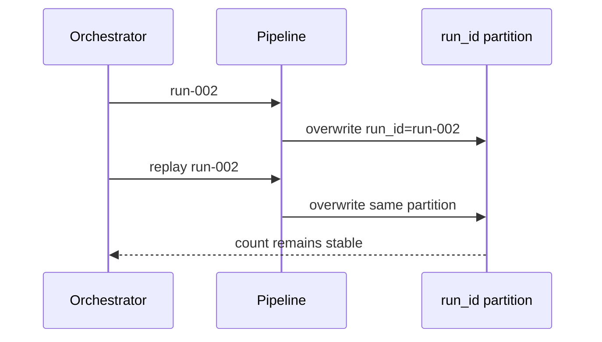

This is scoped same-batch idempotency—not general ACID transactions or concurrent upserts.

---

# Reports come from destination data

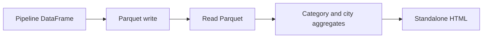

Reading back verifies the published artifact rather than merely displaying an in-memory intermediate.

---

# Production extensions

- Orchestration and durable run-control metadata
- Schema contracts and evolution policy
- Atomic commits or transactional tables where needed
- Monitoring, alerts, lineage and retention
- Access control, encryption and secret management
- Representative performance testing
- Conflict handling for duplicate and late-arriving records

---

# Knowledge check

1. What triggers a Spark job?
2. Why use `try_cast` for dirty text?
3. How do you find an orphan product key?
4. Why does `groupBy` commonly shuffle?
5. When is broadcast join appropriate?
6. Why is `coalesce(1)` not a default solution?
7. What does replay-safe mean in this project?

---

# Final outcome

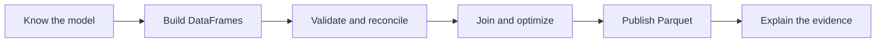

You now have a complete, inspectable pipeline—not just a collection of API examples.

