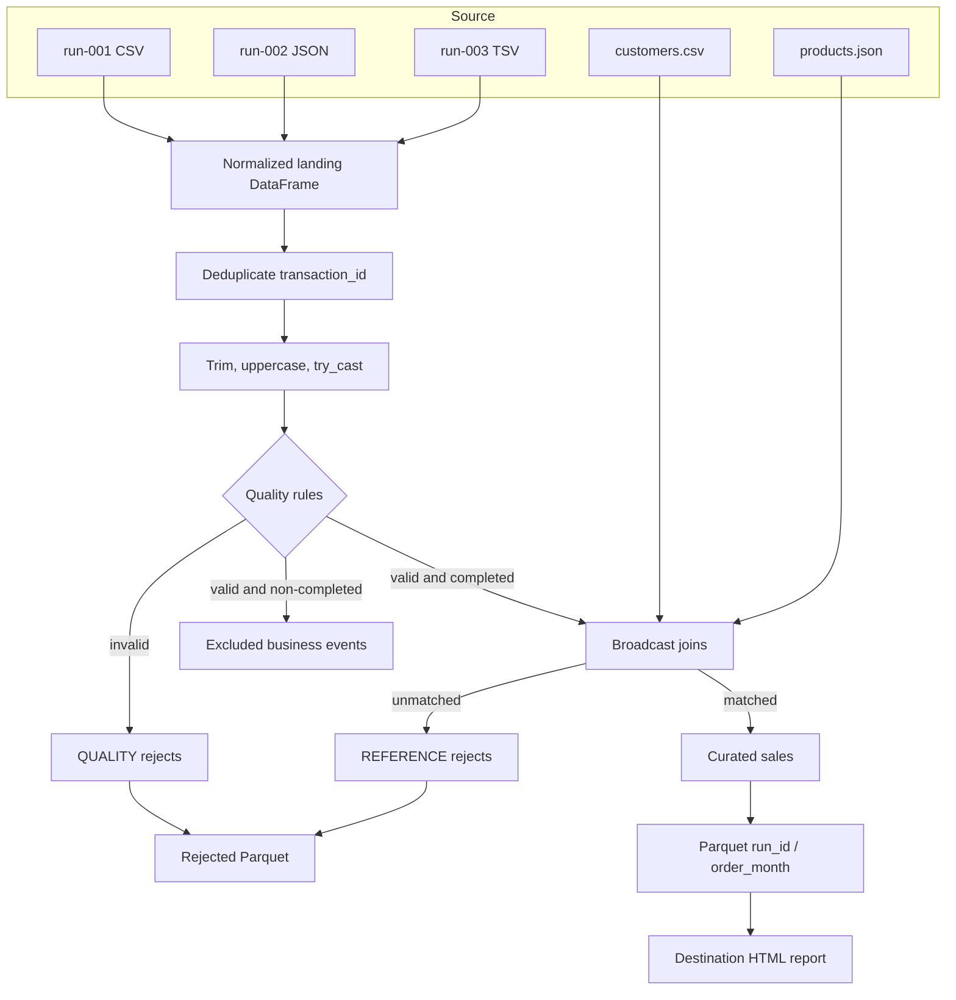

# Guided project — e-commerce batch pipeline

## Business request

An e-commerce team receives transaction batches from different partners. Partners deliver the same logical columns in CSV, newline-delimited JSON or TSV. The analytics destination must contain only completed, type-valid transactions whose customer and product identifiers exist in the supplied references.

For every run, the team needs:

1. Curated sales in replay-safe partitioned Parquet.
2. Rejected records with an actionable reason.
3. Audit metrics that reconcile the batch.
4. A visual HTML report produced from destination data.

## Scope and constraints

- Core PySpark only; no Delta Lake.
- Local `local[2]` execution for training.
- Small broadcastable customer and product references.
- Synthetic data only.
- Batch-level overwrite by `run_id` to make same-batch replay repeatable.
- No claims of ACID transactions or safe concurrent writers.

## Data contract

| Landing field | Landing type | Curated field | Curated type | Rule |
|---|---|---|---|---|
| transaction_id | string | transaction_id | string | Required; deduplication key within a batch |
| transaction_date | string | order_date | date | Must parse as a date |
| customer_id | string | customer_id | string | Required and must match customer reference |
| product_id | string | product_id | string | Required and must match product reference |
| quantity | string | qty | integer | Positive integer |
| unit_price | string | price | decimal(12,2) | Non-negative |
| status | string | status | string | COMPLETED, CANCELLED or RETURNED |
| — | — | line_total | decimal | `qty * price` |
| — | — | order_month | string | Parquet partition derived from order date |

## Pipeline design



## Physical layout

```text
project/
├── run_config.json
├── pipeline.py
├── reference/
│   ├── customers.csv
│   └── products.json
├── source/
│   ├── run-001/transactions.csv
│   ├── run-002/transactions.json
│   └── run-003/transactions.tsv
├── destination/                  # generated
│   ├── curated_sales/run_id=.../order_month=.../
│   ├── rejected_records/run_id=.../reject_stage=.../
│   └── audit/run_id=.../
└── reports/                      # generated standalone HTML
```

## Audit reconciliation

For each run:

```text
raw_rows - duplicate_rows = unique_rows
unique_rows - quality_rejected_rows = valid_rows
valid_rows - non_completed_rows = completed_rows
completed_rows - reference_rejected_rows = accepted_sales_rows
```

Rejected rows are `quality_rejected_rows + reference_rejected_rows`. A duplicate is measured separately, while a cancelled or returned record is valid but not a completed sale.

## Running the project

Open `project-notebooks/07_guided_project_starter.ipynb` and run from the first cell. It deliberately exposes intermediate DataFrames before calling the reusable `run_pipeline` orchestration function.

The trainer's compact solution is `project-notebooks/08_project_reference_solution.ipynb`.

## Report design

The report generator uses no plotting dependency. It reads the destination Parquet, aggregates small category/city results, and builds a standalone HTML file with KPI cards, bar views and a table. This keeps the cloned environment reproducible while making the output easy to open in any browser.

## Production discussion

Ask learners what would change in a real platform:

- Durable run-control table and orchestration.
- Atomic commits or a transactional table format if concurrent writes/upserts are needed.
- Object-store-safe commit protocol.
- Schema evolution policy and contracts.
- Secret management, authorization and encryption.
- Monitoring, alerting, lineage and retention.
- Volume-aware partition sizes and cluster configuration.
- Tests for conflicting duplicates and late-arriving corrections.

