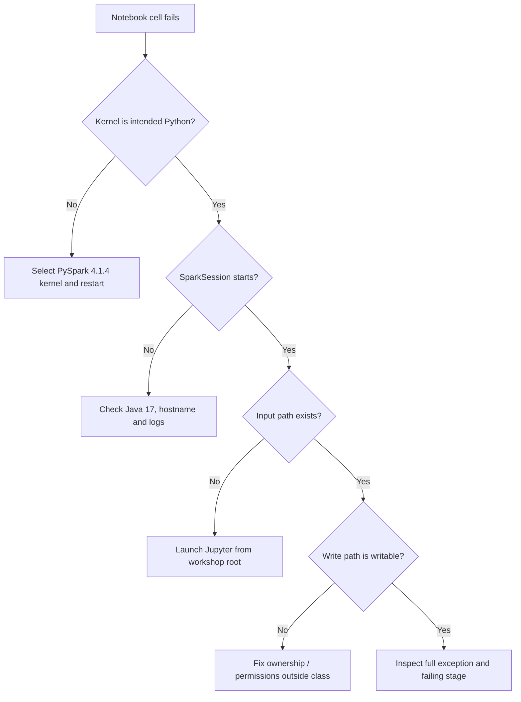

# Setup verification and troubleshooting

Installation is outside the eight-hour teaching window. Both participants use cloned Ubuntu environments, so validate the source image before cloning and run a short check on each clone.

## Expected environment

| Component | Expected |
|---|---|
| Operating system | Ubuntu 22.04 LTS x86_64 |
| Java | OpenJDK 17 |
| Python | 3.12.x |
| PySpark | 4.1.4 |
| JupyterLab | 4.x |
| Kernel | PySpark 4.1.4 (Python 3.12) |
| Spark master | `local[2]` |

The optional installer is under `setup-installer/ubuntu-pyspark-setup/`. Use it to prepare or repair the base image before the workshop, not during instruction.

## Trainer preflight

Run on the Ubuntu base image:

```bash
cd apache_spark_4_1_ubuntu_training
java -version
python3.12 --version
python3.12 -c "import pyspark; print(pyspark.__version__)"
bash setup-installer/ubuntu-pyspark-setup/02-validate.sh
python3.12 scripts/validate_package.py
python3.12 scripts/smoke_test.py
```

Start Jupyter with the supplied launcher or the environment's known-good launcher:

```bash
bash scripts/launch_jupyter.sh
```

Open the PySpark 4.1.4 kernel and run:

```python
import sys
print(sys.executable)
print(sys.version)
print(spark.version if "spark" in globals() else "Create SparkSession")
```

The supplied notebooks create their own `SparkSession`; they do not require a pre-created `spark` variable.

## Clone verification

On each cloned machine:

- [ ] System date/time is sensible.
- [ ] At least 8 GB RAM is available; close unnecessary applications.
- [ ] Workshop folder is owned by the learner and writable.
- [ ] Java 17 and Python 3.12 commands resolve.
- [ ] Jupyter shows the intended kernel.
- [ ] `scripts/smoke_test.py` passes.
- [ ] Browser can open the local Jupyter URL.
- [ ] `output/`, `project/destination/` and `project/reports/` are writable.
- [ ] The final project notebook opens without trust or JSON errors.

## Fast notebook smoke check

```python
from pathlib import Path
from training_lib import create_spark

spark = create_spark("classroom-preflight")
probe = spark.createDataFrame([(1, "ready"), (2, "ready")], ["id", "state"])
path = Path("output/preflight_parquet")
probe.write.mode("overwrite").parquet(str(path))
assert spark.read.parquet(str(path)).count() == 2
print("PREFLIGHT PASS", spark.version, spark.sparkContext.master)
```

## Troubleshooting decision flow



## Common problems

### Kernel and terminal use different Python

Symptom: package exists in the shell but the notebook cannot import it.

```python
import sys
print(sys.executable)
```

Choose the intended Jupyter kernel or launch Jupyter from the prepared environment. Do not install packages into an unknown running kernel during the session.

### Java gateway fails to start

Check:

```bash
java -version
echo "$JAVA_HOME"
python3.12 -c "from pyspark.sql import SparkSession; print(SparkSession.builder.master('local[2]').getOrCreate().version)"
```

The launchers set `SPARK_LOCAL_IP=127.0.0.1` for local use. Review the first Java error rather than only the final Python gateway message.

### Workshop files are not found

Launch Jupyter in the workshop root. The notebook helpers search parent directories for `training_lib.py` and `project/run_config.json`.

```bash
cd /path/to/apache_spark_4_1_ubuntu_training
bash scripts/launch_jupyter.sh
```

### Cast fails on malformed data

Spark 4 uses ANSI behavior. The materials intentionally use SQL `try_cast` for dirty text. Confirm that the cell uses:

```python
F.expr("try_cast(quantity as int)")
```

### Output path already exists

Training writes use `mode("overwrite")`. Verify the path is inside the workshop output or project destination before rerunning. Never redirect an overwrite cell to an unrelated path.

### Report total differs

Check in this order:

1. Raw and duplicate counts.
2. Quality rejects and reasons.
3. `COMPLETED` filter.
4. Unknown customer/product keys.
5. Reference key uniqueness.
6. Decimal calculation and final aggregation.

### Too many active kernels

Each kernel can own a Spark JVM. Shut down unused kernels. With local machines, keep one main notebook kernel active per learner.

### Mermaid does not render

Use a Markdown viewer with Mermaid support. The documents include prose and tables so training can continue without diagrams.

## Recovery policy during delivery

If a learner's environment cannot be repaired within five minutes, pair both learners on the healthy clone and continue. Use a break to repair the failed clone. Protect the project time rather than turning the class into an installation session.

