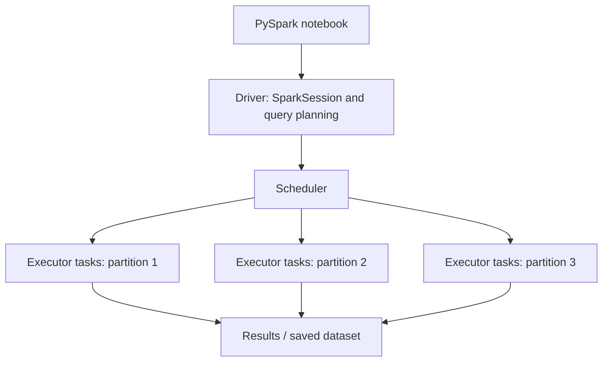

# 01. Introduction to Apache Spark

**Duration:** 30 minutes  
**Notebook:** `01_introduction.ipynb`  
**Outcome:** Explain when Spark helps, identify driver/executors/partitions, and distinguish a transformation from an action.

---

## Why do we need Spark?

A data analyst might inspect 100,000 rows with SQL or Python. In business, a transaction system can create millions or billions of records, and one computer's memory or time may not be sufficient. Spark provides an engine for executing data processing tasks using multiple CPU cores or multiple machines, with high-level DataFrame and SQL APIs.

**Important nuance:** Spark is not automatically faster for small files. Starting the JVM, scheduling tasks, and moving data involve overhead. For a small lookup, plain Python or SQL can be simpler and faster.

### Four common needs

- Read files from common formats and storage systems.
- Transform, filter, join and summarize large datasets.
- Process in parallel across partitions.
- Save reusable results for downstream analytics.

## The architecture at a glance



**Driver:** Entry point coordinating the Spark application and scheduling work. In this workshop, the notebook runs the driver locally.  
**Executors:** Compute resources that process tasks and can cache data; in a real cluster these typically run across worker nodes. In local mode, tasks run locally rather than on separate machines.  
**Partitions:** Units into which Spark divides data for parallel computation. Partitions are *not* equal to rows, CPU cores, database partitions, or machines.  
**Task:** Work assigned to process one partition within a stage.

### Processing flow


A Spark DataFrame program builds a plan; Spark starts actual execution on an **action** such as `show()`, `count()`, `collect()`, or a write operation.

## API example

```python
from pyspark.sql import SparkSession, functions as F
spark = SparkSession.builder.master('local[2]').appName('Intro').getOrCreate()

df = spark.range(1, 11)
transformed = df.withColumn('double_id', F.col('id') * 2)  # transformation
transformed.show()  # action
```

Use the notebook to show `spark_partition_id()` and how many partitions were created. The example is illustrative; repartitioning and scheduling are not meaningful performance benchmarks on a few records.

## Useful comparisons

| Concept | Description | Example |
|---|---|---|
| DataFrame | Distributed, named-column dataset | Transactions loaded from CSV |
| Transformation | Builds a new DataFrame plan | `filter`, `select`, `withColumn`, `join` |
| Action | Triggers execution | `show`, `count`, `write` |
| Narrow transformation | Each output partition depends on limited input partitions | `filter`, most `select` operations |
| Wide transformation | Usually requires data redistribution | `groupBy`, many joins |
| Local mode | Spark jobs run on one machine | `.master('local[2]')` |
| Cluster mode | Distributed execution across workers | YARN / Kubernetes / Spark standalone |

## Participant activity (8 minutes)

1. Start a local SparkSession.
2. Create a DataFrame with numbers 1–12 and four partitions.
3. Add a derived column containing the original number times 2.
4. Use `show()` and `count()`; identify the action.

## Quick discussion

**Q:** Why can a DataFrame support the same operations with 1,000 rows and millions of rows?  
**A:** The API describes transformations; Spark chooses a distributed execution plan using partitions and tasks.

**Q:** Is a Python list the same as a Spark DataFrame?  
**A:** No. Lists are regular Python objects in one Python process; Spark DataFrames represent distributed query plans executed by Spark.

**Q:** Does Spark eliminate the need for SQL?  
**A:** No. Spark SQL is a major part of Spark and supports familiar SQL queries against DataFrames and tables.

**Checkpoint:** Students can explain a driver, a partition, and an action without relying on jargon.
