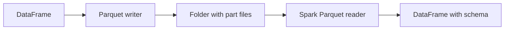

# 02. Getting Started with PySpark

**Duration:** 45 minutes  
**Notebook:** `02_getting_started.ipynb`  
**Outcome:** Create a SparkSession, load CSV/JSON/TSV, create a DataFrame from Python values, and read/write Parquet.

---

## The environment

The workshop uses Ubuntu 22.04 LTS, OpenJDK 17, Python 3.12.3, and Spark 4.1.x in Jupyter. The notebook must have access to both `pyspark` and a working Java executable. Run the preflight and smoke test before the group joins.

```python
import sys
import pyspark
print(sys.executable)
print(pyspark.__version__)
```

## Create SparkSession

```python
from pyspark.sql import SparkSession
spark = (SparkSession.builder
    .master('local[2]')
    .appName('Ecommerce-Foundations')
    .config('spark.sql.shuffle.partitions', '4')
    .getOrCreate())
print(spark.version)
```

The common helper in `training_lib.py` creates the same session, while also directing local Python workers to the notebook's interpreter. `SparkSession` is the normal DataFrame/SQL entry point. `local[2]` is two local execution threads, not a cluster with two nodes.

## Loading structured files

**CSV:**

```python
transactions = (spark.read.option('header', True)
                .csv('data/transactions.csv'))
transactions.printSchema()
transactions.show(5, truncate=False)
```

Most data fields will initially be strings, which is deliberate: the transactions file includes invalid numeric strings and nulls. Real projects often define explicit schemas after agreeing on data-quality rules rather than accepting all inferred types.

**JSON Lines (one object per line):**

```python
products = spark.read.json('data/products.json')
products.printSchema()
```

**TSV:**

```python
products_tsv = (spark.read.option('header', True)
                .option('sep', '\t')
                .csv('data/products.tsv'))
```

**Python values:**

```python
sample = spark.createDataFrame([('Pune', 20), ('Mumbai', 30)], ['city', 'orders'])
sample.show()
```

This is useful for small teaching samples. Large production data should normally be read from files or storage systems rather than materialized as Python lists on the driver.

## What happens with Parquet?



Parquet is columnar and retains a structured schema. CSV is text; it needs parsing and explicit interpretation of types. Spark writes a Parquet dataset as a **directory**, potentially with several part files.

```python
products.write.mode('overwrite').parquet('output/products_sample_parquet')
reloaded = spark.read.parquet('output/products_sample_parquet')
reloaded.printSchema()
```

Only write into `output/` in these demonstrations. Overwrite mode replaces the **destination dataset path**, not an individual row.

## Reading and verifying results

| Function | Purpose |
|---|---|
| `printSchema()` | Types and nested structure |
| `show(5, truncate=False)` | Preview selected records |
| `count()` | Number of records (triggers a job) |
| `columns` | List the column names |
| `dtypes` | Column names and Spark types |
| `limit(5)` | Construct a limited DataFrame (action only when displayed/collected) |

## Participant exercises (12 minutes)

1. Read `customers.csv` and display its first five records.
2. Read `products.json`, print its schema, and count records (expected: **12**).
3. Read `products.tsv` by setting the delimiter to a tab. How does its schema differ from JSON?
4. Save products to Parquet and read them back. Verify the row count remains 12.

## Common mistakes and answers

**Why didn't one `.parquet` file appear?** Spark writes a dataset directory; check its `part-*` files.  
**Should I always use `inferSchema=True`?** No. It performs type inference; this workshop deliberately preserves raw string fields so bad values can be identified.  
**What is the difference between `read` and `write`?** The reader creates a DataFrame from sources; the writer is an action that persists output.

**Checkpoint:** Students can load CSV, JSON and TSV independently and complete a local Parquet round-trip.
