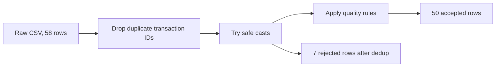

# 03. DataFrame Fundamentals

**Duration:** 75 minutes  
**Notebook:** `03_dataframe_fundamentals.ipynb`  
**Outcome:** Select, filter, derive, cast and clean data; recognize duplicates, bad types and missing values.

---

## The business problem

An online retailer receives transactions from multiple sources. Some are repeated, have missing quantities or prices, or refer to products that do not exist. An analytical report should not treat all incoming rows as reliable facts.



## Select the required fields

```python
raw.select('transaction_id', 'product_id', 'quantity', 'status').show(10)
```

Use `select` rather than transporting every column through every transformation. A Spark DataFrame is immutable: selecting columns produces a new DataFrame; it does not change the original.

## Filter rows

```python
from pyspark.sql import functions as F
completed = raw.filter(F.col('status') == 'COMPLETED')
completed.show(5)
```

Multiple conditions require careful parentheses because PySpark uses `&` and `|` for column expressions:

```python
raw.filter(
    (F.col('status') == 'COMPLETED') &
    (F.col('product_id') == 'P001')
).show()
```

## Derive a column

A new field can be created with `withColumn`:

```python
example = spark.createDataFrame([(2, 199.0), (3, 50.0)], ['qty', 'price'])
example = example.withColumn('line_total', F.col('qty') * F.col('price'))
example.show()
```

In the project, money uses a Spark **DECIMAL** type rather than floating-point arithmetic to avoid avoidable rounding surprises.

## Cast types safely

Spark 4.1 can raise an exception for malformed `cast()` inputs under ANSI behavior. Our raw quantity sometimes contains `not-a-number`. Use `try_cast` to produce `NULL` and isolate the failed records:

```python
typed = (raw
    .dropDuplicates(['transaction_id'])
    .withColumn('order_date', F.expr('try_cast(transaction_date as date)'))
    .withColumn('qty', F.expr('try_cast(quantity as int)'))
    .withColumn('price', F.expr('try_cast(unit_price as decimal(12,2))')))
```

**Why use `try_cast`?** An invalid string turns into null, so the batch can continue and the record can be reported/rejected deliberately. This does **not** mean errors should always be silently swallowed. Keep visibility of rejected rows.

## Missing values and duplicates

```python
raw.groupBy('transaction_id').count().filter(F.col('count') > 1).show()
```

There are **58 raw records** but **57 distinct transaction IDs**, because one identical source transaction is repeated. `dropDuplicates(['transaction_id'])` is appropriate for this known duplicate. If duplicate IDs had conflicting values, a real pipeline would need a deterministic winner rule (for example, latest update timestamp) instead of arbitrary deduplication.

Missing and malformed rows are recognized after typing:

```python
from training_lib import quality_condition
rejected = typed.filter(~quality_condition())
rejected.select('transaction_id','quantity','unit_price','transaction_date').show()
```

Rules: parsed date must exist; qty must be positive; price must be nonnegative; customer ID and product ID must not be blank/null. Exactly **7** rows fail these basic rules after deduplication. Those failures include null or invalid quantity, price, date and missing keys.

A product ID like `P999` is not an empty key; it is an *unknown reference*. That is a different quality issue which we detect during joins, not during basic type validation.

## Clean and derive final amount

```python
clean = (typed
    .filter(quality_condition())
    .withColumn('line_total', F.col('qty') * F.col('price')))
assert clean.count() == 50
```

## Why avoid `collect()` on large data?

`collect()` moves all result rows to the Python driver. It is fine for tiny checks, but dangerous for large production datasets. Prefer `show()`, grouped metrics, or persisting the result. `toPandas()` is also driver-memory bound.

## Practice lab (25 minutes)

1. Show the IDs of transactions with more than 2 items.
2. Count transactions by status in the cleaned dataset.
3. Identify records with invalid typed dates or prices.
4. Verify `58 raw → 57 unique → 50 clean`.
5. Explain why `P999` should remain after basic type validation but must be excluded if it cannot match the product master.

## Interview-style quick checks

**Q:** `drop()` vs `dropDuplicates()`?  
**A:** `drop()` removes columns; `dropDuplicates()` removes repeated rows/keys.

**Q:** `filter()` vs `where()`?  
**A:** Both filter rows; `where` is an alias for `filter`.

**Q:** `cast()` vs `try_cast()`?  
**A:** A strict cast may error on malformed strings; `try_cast` yields null for invalid input.

**Q:** Can `fillna()` fix all missing values?  
**A:** No. Filling only makes sense when the chosen replacement has business meaning. For unknown transaction quantity or price, rejection or remediation is usually safer than inventing values.

**Checkpoint:** 50 base-quality rows are ready for aggregation and reference joins.
