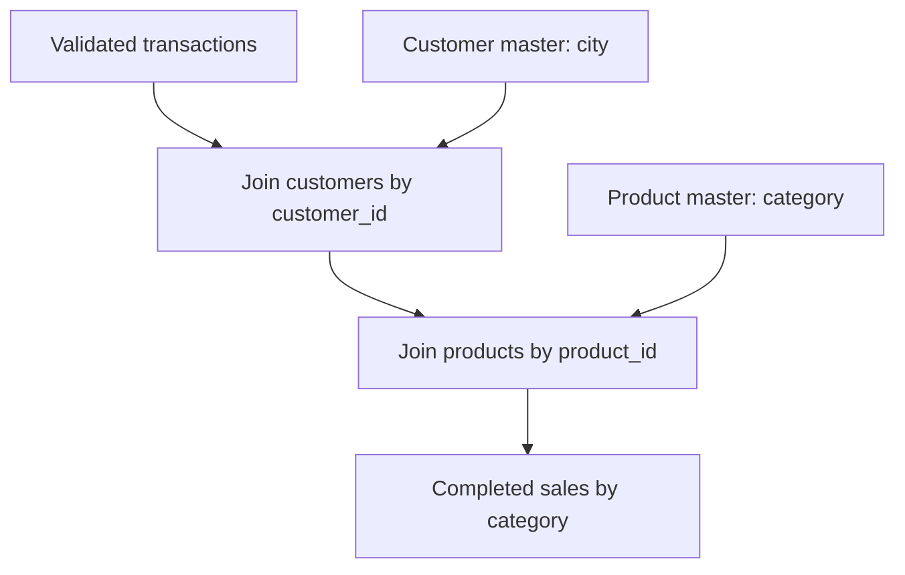

# 05. Joining and Saving Data

**Duration:** 60 minutes  
**Notebook:** `05_joins_and_saving.ipynb`  
**Outcome:** Explain join types, diagnose unmatched foreign keys, and save Parquet/CSV summary folders.

---

## The reference-data problem

A transaction has `product_id` and `customer_id` fields, but the sales CSV does not contain category and city. We need to combine the fact records with product and customer reference datasets.



Two intentional source exceptions are present: `P999` is missing from products, and `C999` is missing from customers. They look like non-empty IDs and pass simple column validation, but cannot be matched to reference data.

## Inner join

```python
completed = clean.filter(F.col('status') == 'COMPLETED')
with_customer = completed.join(customers, 'customer_id', 'inner')
with_both = with_customer.join(products, 'product_id', 'inner')
```

An inner join keeps only rows with matching keys on both sides. It is correct here because the sales metric explicitly excludes transactions with unknown product or customer references. In a different business use case, rejecting those transactions could hide important operational problems; keep a reject report as well.

## Left join

```python
left_view = completed.join(products, 'product_id', 'left')
left_view.filter(F.col('category').isNull()).show()
```

A left join keeps all left-hand rows, even if a product is missing. The product fields appear as null for unmatched rows. This is useful for diagnosing reference integrity instead of quietly losing records.

## Left-anti join

```python
unmatched_products = completed.join(products.select('product_id'), 'product_id', 'left_anti')
unmatched_customers = completed.join(customers.select('customer_id'), 'customer_id', 'left_anti')
unmatched_products.select('transaction_id', 'product_id').show()
unmatched_customers.select('transaction_id', 'customer_id').show()
```

Each anti join produces **one** unmatched completed row in the supplied dataset. An anti join returns left-side rows with no matching key on the right.

## Join-type mental model

| Join | Keeps | Workshop example |
|---|---|---|
| Inner | Only matching rows | Accepted reporting facts |
| Left | All left rows; nullable dimension fields | Find unresolved category |
| Right | All right rows; nullable fact fields | Include every product even if unsold |
| Full | All rows from both sides | Compare two inconsistent sets |
| Left semi | Left rows that have a right match (no right columns) | Membership check |
| Left anti | Left rows without a right match | Reject / missing reference report |

**Caution:** Duplicate keys in a reference table can multiply matching rows and inflate revenue. In this workshop, product and customer keys are unique. In production, validate them before joining.

## Saving data to Parquet

```python
from training_lib import completed_enriched, revenue_by_category
enriched = completed_enriched(clean, customers, products)
report = revenue_by_category(enriched)
report.write.mode('overwrite').parquet('output/category_revenue_parquet')
```

Then read the saved folder:

```python
loaded = spark.read.parquet('output/category_revenue_parquet')
loaded.orderBy('category').show()
```

The notebook resolves the full workshop path to avoid issues when Jupyter starts in `notebooks/`.

## Saving a CSV summary

```python
report.write.mode('overwrite').option('header', True).csv('output/category_revenue_csv')
```

Spark generally writes a directory containing one or more `part-*` files rather than a named `report.csv`. Production output naming, retention and overwrite safeguards are an additional orchestration concern.

## What changes when the output is larger?

When production datasets are large, think about partition counts, shuffle volume, and write patterns. Avoid forcing everything into one partition (`coalesce(1)`) just to obtain one file. That pattern creates a bottleneck for large outputs.

## Practice lab (20 minutes)

1. Join completed transactions to customers. Display transaction ID, customer name and city.
2. Join the result to products, and show product name/category.
3. Find orphan product and customer references using anti joins.
4. Save the four-row category report as Parquet; read it back and verify `count() == 4`.
5. Explain why a left join is more useful than inner join during diagnostic checks.

## Likely questions

**What happens when the join key is NULL?** Standard equality joins do not match null to null. Null-safe equality is possible but should be a conscious business decision.  
**Does inner join guarantee no duplicates?** No; duplicate keys on either side can produce many-to-many row multiplication.  
**Is Parquet a database?** No, it is a columnar file format; a directory of Parquet files is not automatically a managed transaction table.

**Checkpoint:** The output summary has four rows, and the attendee can explain why P999 and C999 were excluded.
