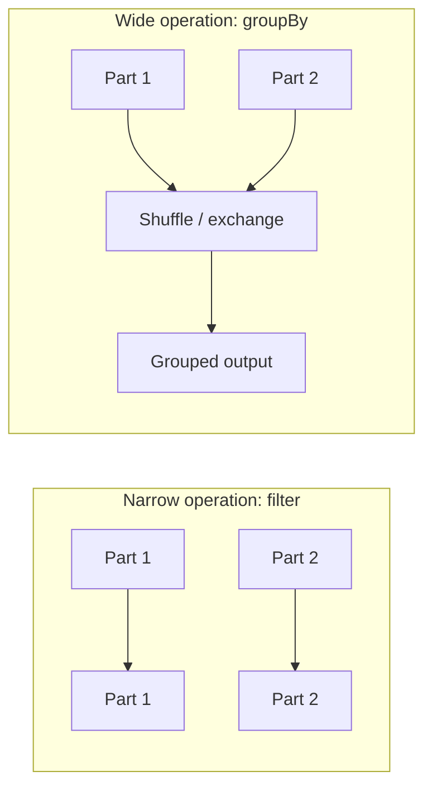

# 06. Execution and Performance Basics

**Duration:** 30 minutes  
**Notebook:** `06_execution_and_performance.ipynb`  
**Outcome:** Explain laziness, task partitions, shuffle boundaries, `explain()`, and careful use of caching.

---

## Why does the same code sometimes run slowly?

Spark programs describe **what** to compute. Their performance depends on input size, partitioning, data skew, shuffles, join strategy, file sizes, memory, CPU, and available worker resources. Understanding these concepts is more valuable than memorizing one optimization switch.

## Lazy evaluation

```python
selected = clean.filter(F.col('status') == 'COMPLETED')
summary = selected.groupBy('product_id').count()
# The expressions above build a plan.
summary.show()  # Triggers execution.
```

A transformation is not a promise that nothing at all happens in the Python process; rather, it means Spark does not execute the *distributed computation* until an action requires it.

## Explain a plan

```python
summary.explain('formatted')
```

Read the output for scans, filters, exchanges (data redistribution), and aggregates. Spark may change its physical plan as it learns runtime statistics. The Spark UI, typically at `http://localhost:4040`, is useful when available; the port may change if several applications are running.

## Narrow vs wide



`filter` and `select` are usually narrow because each output partition can be computed from one input partition. A `groupBy` usually redistributes keys to the same downstream partitions. A join can shuffle, but the optimizer may choose a **broadcast join** when one side is small.

## Partition count

```python
print(clean.rdd.getNumPartitions())
repart = clean.repartition(4, 'product_id')
print(repart.rdd.getNumPartitions())
```

`repartition` can trigger a shuffle. More partitions are not always faster: very small partitions add scheduler overhead and too few partitions reduce parallel work. The workshop sets shuffle partitions to four for lightweight demonstrations, not as a universal recommendation.

## Cache and reuse

```python
shared = clean.filter(F.col('status') == 'COMPLETED').cache()
shared.count()  # First action computes and populates cache.
shared.groupBy('product_id').count().show()
shared.unpersist()
```

Caching is helpful when the same transformed dataset is reused for multiple expensive actions and memory is available. Caching every DataFrame wastes resources. Compare explain plans and actual workloads; don't claim speedups based on this 58-row toy dataset.

## Sensible Spark habits

- Read only necessary columns, filter as early as business correctness permits.
- Use built-in DataFrame/SQL functions before considering Python UDFs.
- Avoid `collect()` for large DataFrames, especially in shared notebook servers.
- Inspect execution plans for heavy join/groupBy operations.
- Verify output correctness first; optimize after measuring bottlenecks.
- Avoid a single huge output partition just to make a conveniently named file.

## Practice lab (8 minutes)

1. Build a grouped summary and call `.explain('formatted')`.
2. Point out a likely `Exchange`/shuffle in the plan.
3. Repartition data into four partitions and display partition ID counts.
4. Cache a DataFrame, perform two actions, then unpersist it.

## Quick questions

**Is `cache()` an action?** No. It marks a DataFrame for caching when computed by an action.  
**Does every join require a shuffle?** No; for example, broadcast joins can avoid a large two-sided shuffle.  
**Does more memory always fix a slow query?** No. Skew, network exchange, data format and algorithmic behavior may dominate.  
**Is `groupBy` always expensive?** Cost depends on data size and distribution; grouping commonly triggers shuffle.

**Checkpoint:** Students can identify an action, interpret the significance of `Exchange`, and explain when caching is sensible.
