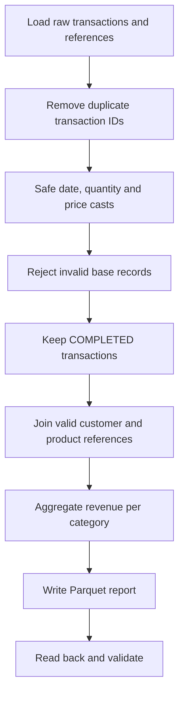

# 07. Guided Mini-Project — E-commerce Sales Analytics

> For the final 150-minute, three-run CSV/JSON/TSV project, use [`../PROJECT_GUIDE.md`](../PROJECT_GUIDE.md) and [`../project-notebooks/07_guided_project_starter.ipynb`](../project-notebooks/07_guided_project_starter.ipynb). This note describes the shorter original exercise.

**Duration:** 60 minutes, plus 15 minutes for validation after the project  
**Notebooks:** `07_guided_project_starter.ipynb` and `08_project_reference_solution.ipynb`  
**Final deliverable:** A working notebook and `output/project_category_revenue_parquet/` containing the completed-sales summary.

---

## Industry-style requirement

An e-commerce business exports daily transaction records and keeps customer/product reference files. Build a small, auditable pipeline that produces **completed revenue by product category**. The incoming transaction data is unreliable and can contain missing values, duplicates, invalid types, cancelled/returned statuses, and reference IDs absent from dimension tables.

### Source files

| File | Format | Key fields | Purpose |
|---|---|---|---|
| `transactions.csv` | CSV | transaction_id, transaction_date, customer_id, product_id, quantity, unit_price, status | Transaction facts |
| `customers.csv` | CSV | customer_id, customer_name, city | Customer reference |
| `products.json` | JSON Lines | product_id, product_name, category, list_price | Product reference |
| `products.tsv` | TSV | product_id, product_name, category, list_price | Alternative format demonstration |

## Required steps

### The contract

- Use unique `transaction_id` values and do not double-count a duplicated row.
- A valid transaction has a parseable date, integer quantity greater than zero, decimal price greater than or equal to zero, and nonempty customer and product keys.
- Revenue is counted only for `COMPLETED` transactions whose product ID and customer ID match the references.
- `line_total = qty * price`.
- The report includes `category`, `orders` (`countDistinct(transaction_id)`) and `revenue` (`sum(line_total)`).
- Output is a Parquet **directory**, created under `output/`.

## Exercise steps and timings

| Time | Step | Observable result |
|---|---|---|
| 0–10 min | Load and inspect | 58 raw records |
| 10–25 min | Deduplicate, safely cast, clean | 57 unique IDs; 50 clean rows |
| 25–40 min | Apply status / dimension joins | 36 qualified completed sales |
| 40–50 min | Aggregate and export | Four categories, Parquet directory |
| 50–60 min | Check counts and totals | Total 342228.00 |

Use **`07_guided_project_starter.ipynb`** for these activities. Its core cells deliberately contain TODOs. It is not an executable finished pipeline until participants fill them in.

## Expected validation results

| Metric | Expected |
|---|---:|
| Raw transactions | 58 |
| Unique transaction IDs | 57 |
| Rejected for basic quality (after dedup) | 7 |
| Accepted base-quality rows | 50 |
| Completed with valid reference keys | 36 |
| Unknown product IDs among completed | 1 (`P999`) |
| Unknown customer IDs among completed | 1 (`C999`) |
| Output categories | 4 |
| Total completed revenue | 342228.00 |

**Category totals:** Accessories 52574.00; Audio 20992.00; Electronics 265968.00; Stationery 2694.00.

## Extra challenges (only if participants finish early)

1. Produce a separate daily-revenue DataFrame by `order_date`.
2. Write a rejection report for unknown product/customer references, without adding those rows to revenue.
3. Write an equivalent Spark SQL category summary and verify identical totals.
4. Discuss whether a refund processed after completion requires a different metric definition. This exercise intentionally treats `RETURNED` as excluded rather than modeling ledger-level negative adjustments.

## Acceptance checklist

- [ ] The notebook executes without errors on Spark 4.1.x.
- [ ] No malformed quantity, date or price causes the notebook to abort.
- [ ] Duplicate source rows do not inflate revenue.
- [ ] Missing reference IDs are explicitly accounted for.
- [ ] Output has exactly four categories and the expected total.
- [ ] Parquet output can be read back with a valid schema.

## Debrief questions

**What quality checks would an orchestration service monitor daily?** Row counts, duplicate keys, invalid casting rates, unmatched references, freshness, and revenue reconciliation.  
**What would change with a million-row input?** Storage, partitioning, source throughput, shuffle, joins, monitoring, and resource configuration become more important.  
**Why make the metric definition explicit?** Otherwise the same data may produce multiple conflicting revenue totals when teams handle cancelled and returned records differently.

**Checkpoint:** Each participant can show the completed notebook and a valid exported summary folder.
